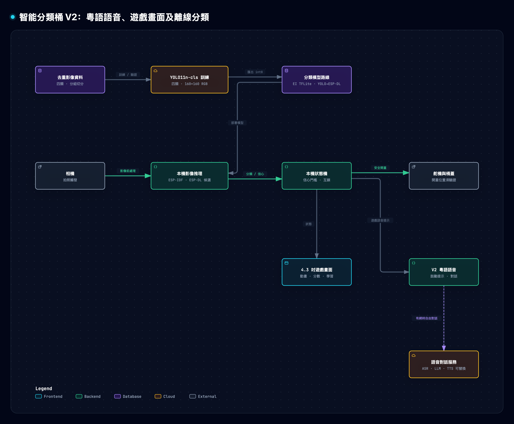

# 智分桶 EDU — AI 益智環保教育互動系統

**項目類型：** 環保教育 × AI 影像辨識 × STEM × 遊戲化學習

**項目階段：** 原型開發與整合

智分桶 EDU 以小學環保教育遊戲攤位為靈感，結合影像辨識、屏幕互動及實體分類桶蓋，讓學生透過分類挑戰認識減廢與回收。主要對象初步聚焦小三至小六學生，並由教師、STEM 導師或活動工作人員協助使用；潛在場景包括校園及社區環保教育活動。

**影像辨識是主要分類方式**：系統擬拍攝物品、判斷分類、在屏幕提供回饋，並控制相應桶蓋。XiaoZhi AI 語音互動是 **V2 規劃**，用於進一步引導、問答和解說。教育成效、適用年齡及操作方式均屬設計假設，仍需學生與教師試用驗證。

開發者請先閱讀 [commit／push／PR 檢查與編譯指南](docs/development.md)。

## 從這裡開始

| 你想做甚麼 | 指南 |
| --- | --- |
| 找到程式入口與了解目前整合邊界 | [架構與依賴](docs/architecture.md) |
| 測試 ESP32-S3 伺服或麥克風 | [Arduino](arduino/README.md)、[ESP-IDF](esp32s3/README.md) |
| 預覽教學畫面 | [UI](ui/README.md) |
| 準備資料、量化或評估模型 | [工具](tools/README.md)、[資料](data/README.md) |
| 查閱實驗證據和待完成項目 | [文件索引](docs/README.md) |

## 系統架構



此圖展示擬議架構，不代表所有元件已完成整合。影像辨識是主要分類流程；語音互動屬 V2。離線分類、狀態機互鎖及完整開蓋流程仍需實機驗證。詳細設計與驗收條件見[系統架構與驗收](docs/system-architecture-decision.md)。

## 擬議遊戲流程

1. 學生啟動分類挑戰，將單件物品放到拍攝區。
2. 系統拍攝物品並以影像模型預測分類。
3. 屏幕顯示分類結果及學習回饋；控制對應桶蓋。
4. 完成多道挑戰後，展示分數及分類知識；獎勵可由活動工作人員派發。
5. V2 可加入 AI 語音引導、問答及解說。

以上是設計方向；相機、模型、屏幕、評分、桶蓋及語音尚未證明已完整串接。低信心或無法辨識的情況應提供人工選擇，詳細驗收見[系統架構與驗收](docs/system-architecture-decision.md)。

## 目前進度

| 部分 | 已有內容與證據 | 仍需完成 |
| --- | --- | --- |
| 四路伺服 | ESP32-S3 的 Arduino 與 ESP-IDF PCA9685 測試可逐一及同時控制通道 0–3。ESP-IDF 6.0.2 已編譯、燒錄並執行；使用者觀察到三個伺服轉動。 | 所有通道的實際動作及通道 0 的低電流原因尚待確認。 |
| XiaoZhi 板型 | `smart-trash-can` 板型提供四路直接 GPIO 伺服控制及 `self.trash_can.*` MCP 工具。 | 與 PCA9685 測試是不同實作；未證明已整合 PCA9685 或完整分類流程。 |
| 4.3 吋介面 | LVGL 9.5 的 800×480 教學介面及 SDL 桌面預覽；包含分類流程、圖鑑和總分頁。 | 目標屏幕、觸控及硬件整合未驗證。 |
| 影像模型 | Edge Impulse、YOLO 與 ESP-DL 的主機評估及 ESP32-S3 實板探測，詳見[模型比較](docs/model-comparison.md)及[現場圖片探測](docs/issue12/field-probe/metrics.md)。 | 共享資料仍有近重複及選模洩漏風險；小樣本測試不能代表現場準確率。S31 實板及整機效能尚待驗證。 |
| ESP32-S31 bring-up | LCD、音訊與迴路測試骨架；相機測試保留待實作。 | 依專案說明，尚未編譯或完成硬件測試；codec 初始化與相機整合未完成。 |

首要目標是完成影像分類與基本教育互動；V2 再探索語音對話。離線流程、拍照至開蓋延遲及連續十次整機運作尚未驗證。見[系統架構與驗收](docs/system-architecture-decision.md)和[里程碑](docs/ROADMAP.md)。

## 教育定位與評估

傳統分類攤位通常由主持者解釋規則及提供回饋。此原型探索以互動系統支援教育活動，並讓學生透過實物操作學習；其效果尚未得到驗證。後續可透過學生試玩，記錄遊戲前後分類知識、挑戰正確率、操作困難及教師意見。

專案擬用於校園環保日、STEM 活動及社區教育攤位，並對應 CTEA「智慧生活－未來設計師」的智慧教育及智慧環境方向。展示分數、徽章、獎勵及個人化解說均為建議功能，並非已完成的整機能力。

## 快速開始：ESP32-S3 + PCA9685

將 PCA9685 的 `VCC` 接 ESP32-S3 的 3.3 V，`SDA`、`SCL` 接程式中設定的腳位，並共地。程式的 GPIO 8／9 是**範例**，須先確認開發板腳位及接線；預設 I²C 位址是 `0x40`。舵機接驅動板通道 0–3，以符合舵機規格、電流足夠的獨立穩壓電源供應 `V+`，其負極與 ESP32-S3 共地。按模組標示核對訊號、電源和地線；不要用開發板 3.3 V 供應伺服。

測試前解除機械連桿；若卡住立即斷電。四個伺服同時啟動時須確保電源有足夠電流。

### ESP-IDF

安裝並啟用 ESP-IDF 環境，按實際接線編輯 `main/main.c` 的 `SDA_GPIO`、`SCL_GPIO` 及 `PCA_ADDRESS`，然後執行：

```sh
cd esp32s3/pca9685_servo_test
idf.py set-target esp32s3
idf.py build
idf.py -p YOUR_PORT flash monitor
```

程式先逐一移動四個通道，再同時移動；每次輸出 90、60、120、90 度的測試指令。預設序列埠速率為 115200。實際角度取決於伺服及脈寬設定。接線、電源、console 選擇與排錯見[測試說明](esp32s3/pca9685_servo_test/README.md)。

### Arduino IDE

開啟 [`PCA9685_4Servo_Test.ino`](arduino/PCA9685_4Servo_Test/PCA9685_4Servo_Test.ino)，選擇 ESP32-S3 板型，按實際接線修改 `SDA_PIN`、`SCL_PIN` 及位址，再編譯上傳。它只需 Arduino `Wire` 程式庫；序列監控器設為 115200。

## XiaoZhi 直接 GPIO 板型

本板型將四個伺服訊號直接接到 ESP32-S3：可回收物 GPIO9、廚餘 GPIO10、有害垃圾 GPIO11、其他垃圾 GPIO12。伺服使用獨立電源並共地。此接線**不適用於上述 PCA9685 測試**；不要假設兩個程式的 GPIO 配置相同。

```sh
cd xiaozhi-esp32
python scripts/build.py smart-trash-can
idf.py -p YOUR_PORT flash monitor
```

角度、MCP 工具、音訊及 OLED 接線見[板型 README](xiaozhi-esp32/main/boards/smart-trash-can/README.md)。`xiaozhi-esp32/` 來源為 [78/xiaozhi-esp32](https://github.com/78/xiaozhi-esp32)。

## 4.3 吋教學介面

[LVGL 介面](ui/lvgl/README.md)包含桌面預覽、native 渲染評估與 ESP-IDF component 接入說明。預覽使用固定示範資料，沒有操作真實相機、模型或舵機。設計資產及規格位於 [`design/`](design/)。

## 資料集與模型

建置四類資料集的例子：

```sh
python3.11 -m venv .venv-train
. .venv-train/bin/activate
pip install -r tools/requirements-train-macos-arm64.lock.txt
python tools/build_dataset.py --src data/garbage265 --out data/waste4 \
  --per-class-limit 2000 --test-per-class-limit 250 --seed 42
```

來源須包含 `train/`、`val/` 和 `classname.txt`。鎖定套件以 macOS arm64、Python 3.11 測試；大型資料集及模型權重不包括在 repository。下載選項另有 metadata 與依賴要求，見 [`tools/build_dataset.py`](tools/build_dataset.py)。

- [模型比較與證據限制](docs/model-comparison.md)
- [ESP32-S3 TFLite probe](esp32s3/tflite_probe/README.md)及 [Edge Impulse latency probe](esp32s3/ei_latency_probe/README.md)
- [資料集、模型與獨立測試 issue #12](https://github.com/Bruiseunderskin/smart-trash-can/issues/12)

## 專案目錄

| 路徑 | 用途 |
| --- | --- |
| [`arduino/`](arduino/) | ESP32-S3 伺服、PCA9685 和 I2S 麥克風測試 |
| [`esp32s3/`](esp32s3/) | PCA9685、TFLite 和 Edge Impulse 測試專案 |
| [`esp32s31/bringup/`](esp32s31/bringup/) | ESP32-S31-Korvo-1 外設 bring-up 與未完成項目 |
| [`xiaozhi-esp32/`](xiaozhi-esp32/) | 語音助手來源及自訂垃圾桶板型 |
| [`ui/lvgl/`](ui/lvgl/) | 教學介面 component、桌面預覽及測試 |
| [`design/`](design/) | 介面規格、設計 tokens 和資產 |
| [`tools/`](tools/) | 資料集、評估、量化與 LVGL 預覽工具 |
| [`docs/`](docs/) | 系統架構、里程碑、實驗與評估紀錄 |

ESP-IDF 的 `build/`、本機 `sdkconfig`、下載的依賴，以及大型資料和模型產物依各專案設定產生；請查閱個別 README 後重建。
