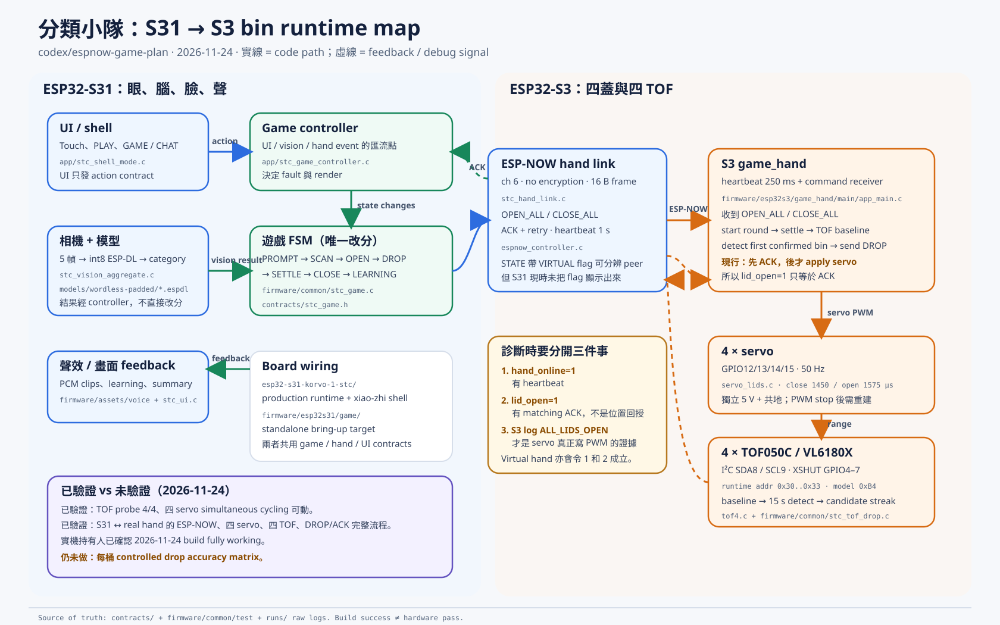
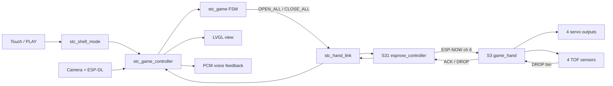

# Agent Repo Map — 分類小隊（S31 / S3 bin flow）

Reader: 任何需要快速理解、修改、診斷或交接此 repo 的 agent。
Last verified branch: `codex/espnow-game-plan`
Last verified commit: `7b141e0` (2026-11-24)
Active hardware branch: `codex/s31-new-model-ui` @ `d70b01e` (2026-11-24)

這份文件是**給 GPT／Codex 的入口地圖**，目的不是取代 README、contracts 或 run log。它回答四條問題：

1. 邊個資料夾負責邊一層？
2. 一個遊戲回合由 UI 到開蓋、TOF、DROP、學習頁怎樣流動？
3. 出問題時應該先看哪個 log／哪個 seam？
4. 哪些事情已被證據證明，哪些仍然只是 code path？



## 1. 30 秒版本

- **S31 = 眼、腦、臉、聲**：相機、模型推理、LVGL UI、遊戲狀態機、模式殼（GAME／CHAT）。
- **S3 = 手**：四支 servo、四個 TOF050C／VL6180X、ESP-NOW peer。
- **板間**：ESP-NOW channel 6、無加密、16-byte `stc_hand_msg_t`。
- **唯一改分數的地方**：`firmware/common/stc_game.c`。UI、model、hand 都只可送 event／view，不可直接改分數。
- **開蓋成功 ≠ 收到 ACK**：現行 S3 在真正套用 servo 前已回 ACK，`view.lid_open` 只代表協議狀態，不是物理位置回授。
- **真實 hand 與 virtual hand 共用同一協議**：`virtual_hand` 的 STATE 會帶 `STC_HAND_FLAG_VIRTUAL`；real `game_hand` 不會。S31 目前未把這個 flag 暴露到 UI／status，容易把 virtual hand 當成真實硬件。

## 2. Repo 拓撲

| 路徑 | 角色 | 讀者先看 |
|---|---|---|
| `app/` | 平台無關的應用層：game controller、shell mode、mode request | `stc_game_controller.c`、`stc_shell_mode.c` |
| `contracts/` | 模組／板間／UI contract；改 interface 先改這裡 | `stc_game.h`、`stc_hand.h`、`stc_ui.h` |
| `firmware/common/` | 可 host-test 的核心：game FSM、hand protocol、TOF detector、preprocess | `stc_game.c`、`stc_hand_link.c`、`stc_tof_drop.c` |
| `firmware/esp32s31/game/` | S31 standalone game bring-up target：Korvo-1 + camera + ESP-DL + ESP-NOW | `main/app_main.cpp`、`main/espnow_controller.c` |
| `firmware/xiaozhi-esp32/main/boards/espressif/esp32-s31-korvo-1-stc/` | S31 整機／xiao-zhi 板型殼：UI/voice/network/game runtime 共存 | `stc_game_runtime.cc`、`esp32_s31_korvo_1_stc.cc` |
| `firmware/esp32s3/game_hand/` | 真實 S3 hand：4 servo + 4 TOF + ESP-NOW | `main/app_main.c`、`main/servo_lids.c`、`main/tof4.c` |
| `firmware/esp32s3/virtual_hand/` | 無硬件 S3 peer；用嚟測 S31 流程 | `main/app_main.c` |
| `firmware/esp32s3/tof4_probe/` | 四 TOF 獨立 bring-up／benchmark | `main/tof4_probe.c` |
| `firmware/esp32s3/servo_lid_test/` | 四 servo 獨立安全測試 | `main/servo_lid_test.c` |
| `ui/lvglpro/` | production LVGL Pro UI source | `src/stc_ui.c`、`src/stc_chat_ui.c` |
| `ui/lvgl/` | 舊版／較細 UI 與 preview | `README.md` |
| `design/` | layout、assets、Figma export 單一來源 | `layout.json` |
| `models/` | int8 `.espdl`、labels、metrics、SHA | `models/wordless-padded/README.md` |
| `data/` | field / training / probe 資料；field-probe 不可混入訓練 | `data/README.md` |
| `tools/` | 資料、量化、評估、LVGL preview、host tests | `tools/README.md` |
| `runs/` | 原始上板 log／render evidence；不是測試規範 | `runs/tof4/2026-11-14/` |

## 3. Bin runtime flow



### Normal round

1. `START`：S31 檢查 hand online，先送 `CLOSE_ALL`，再開新 round。
2. `SCAN`：五幀相機影像 → 聚合 → `stc_game_input(SCAN_RESULT)`。
3. `OPEN_ALL`：controller 經 `hand_open_all` → `stc_hand_link_command` → ESP-NOW。
4. S3 收命令 → 開四蓋 → 應先確認 servo apply 成功，才回 ACK。
5. S3 settle 800 ms → 採四次 TOF baseline → 進入 15 秒偵測。
6. 第一個連續 confirm 的 TOF 成為 selected bin → S3 立即送 `DROP`。
7. S31 驗證 round／seq／open 狀態，接受 DROP；`stc_game.c` 唯一地方 commit 分數。
8. S3 保持三秒 → close → S31 顯示 learning page → NEXT。

### 重要時序陷阱

- S3 `OPEN_ALL` 現時在 `process_hand_frame()` 內先 `send_ack()`，真正 `stc_servo_lids_open_all()` 要下一個 main-loop `apply_round_actions()` 才執行。
- `apply_round_actions()` 若 servo 失敗，只會 local `fail_round()`；S31 已經收到 ACK，仍會顯示 `lid_open=1`。
- 因此診斷時必須分開三個訊號：
  - `hand_online=1`：有 heartbeat。
  - `lid_open=1`：有 matching ACK，不代表機械位置。
  - S3 `ALL_LIDS_OPEN`／servo log：真正有寫 PWM。

## 4. S31 ↔ S3 protocol

- Version：`STC_HAND_MSG_VERSION == 3`
- Frame：16 bytes、packed、CRC16。
- Channel：6、無加密。
- Discovery：
  - S3 每 250 ms broadcast `STATE`。
  - S31 由第一個有效 `STATE` 學 S3 MAC。
  - S3 由第一個有效 `CMD` 學 S31 MAC。
- Actions：`OPEN_ALL`、`CLOSE_ALL`、`OPEN_ALL_HOLD`。
- Flags：`READY`、`OPEN`、`DROP_VALID`、`VIRTUAL`。
- Heartbeat timeout：1 s。
- ACK retries：300 ms timeout，最多 2 次重送。

### Real vs virtual

| Peer | Firmware | STATE flags | 物理意義 |
|---|---|---|---|
| Real | `firmware/esp32s3/game_hand` | `READY` only | servo／TOF |
| Virtual | `firmware/esp32s3/virtual_hand` | `READY \| VIRTUAL` | 假 DROP |

目前 S31 `stc_hand_link.c` 會接收 STATE，但沒有保存 `VIRTUAL`；UI debug badge 亦固定標為 real hand。這是診斷 gap，不應再用 UI badge 判斷對面 firmware 類型。

## 5. 硬件 map

| Bin | Servo signal | TOF XSHUT | TOF runtime address |
|---:|---:|---:|---:|
| 0 recyclable | GPIO12 | GPIO4 | `0x30` |
| 1 food | GPIO13 | GPIO5 | `0x31` |
| 2 hazardous | GPIO14 | GPIO6 | `0x32` |
| 3 other | GPIO15 | GPIO7 | `0x33` |

- TOF I²C：SDA GPIO8、SCL GPIO9、400 kHz。
- Servo：50 Hz，close 1450 µs，open 1575 µs。
- Servo 必須獨立 5 V 供電並與 ESP32-S3 共地。
- TOF 開機全部 XSHUT low；逐支 release、改址、驗證 `MODEL_ID == 0xB4`。

## 6. 2026-11-24 狀態與證據

### 已證實

- TOF 獨立 probe：`TOF_INIT_SUMMARY ready=4/4`，四支都能連續讀取；最快 profile 有 100/100 valid round。
- Servo 獨立／simultaneous cycling：四支都能動。早前 GPIO12／15 不動，追查後證實不是 ESP32-S3 pin 限制，較似接線／接觸問題。
- ESP-NOW S31 ↔ S3 virtual hand：heartbeat、OPEN_ALL、DROP、CLOSE_ALL 曾完整跑通。
- S31 實機 UART `stc status` 回報：
  - `shell=0 voice_mode=0 network=0 hand_online=1`
  - `phase=9 model=1 camera=1 espnow=1 hand_online=1 lid_open=1 fault=-`
  - 這證明 S31 有 peer、有 ACK；**不證明** servo 或 TOF OK。

### 未證實／未完成

- Repo 內沒有一份 tracked `game_hand` 上板成功 log（應有 `SERVO_LIDS ready`、`TOF4 INIT ready=4/4`、`GAME_HAND=READY`）。
- Real `game_hand` 的 S31 → ESP-NOW → 四 servo → 四 TOF → DROP → close raw log 已於 `runs/real-hand/2026-11-24/` 保存；實機持有人於 2026-11-24 確認 build fully working。
- `lid_open` 仍然只是 ACK 狀態，不是 lid 位置回授；機械到位目前靠實機目視確認。
- S31 未顯示 peer 是 virtual 還是 real。
- Active hardware branch 與 `codex/espnow-game-plan` 仍有未合併的 board/UI 修正；交接時要明確指定 build commit。

## 7. 建議診斷順序

### A. 先確認板上 firmware

S3 console（UART0，115200；最新診斷版可加 USB Serial/JTAG secondary）：

```text
GAME_HAND=READY
TOF4: INIT ready=4/4
SERVO_LIDS: ready gpio=12,13,14,15 ...
```

如果完全沒有 boot log：

1. 確認 flash 的是 `firmware/esp32s3/game_hand`，不是 `virtual_hand`。
2. 確認 build 後真的有 flash，不是只 build。
3. 確認 monitor 接到 UART0；若用原生 USB，需 secondary USB console 配置。

### B. 分開測試三層

1. **Servo only**：console `start`；期望 `ALL_LIDS_OPEN` 及四支 servo 動。
2. **TOF only**：`status`／`simdrop 0..3`；再對照 `tof4_probe`。
3. **Link only**：S31 `stc status`；期望 `espnow=1 hand_online=1`。
4. **Real two-board**：S31 scan → `RX_OPEN` → `ALL_LIDS_OPEN` → S31 `lid_open=1` → 手動投放 → `ANSWER_DETECTED` → `DROP_ACK`。

### C. 症狀對照

| 症狀 | 優先假設 | 下一步 |
|---|---|---|
| `hand_online=0` | S3 未 boot、未 heartbeat、channel 不合 | 看 S3 boot；確認 channel 6；訊號距離 |
| `hand_online=1`、`lid_open=1`、servo 不動 | ACK 早於 servo、virtual hand、PWM stop 後未重開、訊號線 | 看 S3 是否有 `RX_OPEN`／`ALL_LIDS_OPEN`；確認不是 virtual flag |
| TOF init 少於 4/4 | XSHUT 時序、供電、I²C 接觸、逐支改址 | 重跑 `tof4_probe`；看哪個 index fail |
| TOF 全 ready 但沒有 DROP | baseline／mounting／FOV／threshold | 看 `BASELINE`、`TOF_CANDIDATE`、`TOF_MISS` |
| S31 收到 DROP 但分數錯 | model class → bin map 或 round／seq stale | 查 `stc_vision_map.c`、`stc_hand_link.c`、`stc_game.c` |

## 8. 修改時的安全邊界

| 想改 | 應改 | 不應改 |
|---|---|---|
| 分數／回合規則 | `firmware/common/stc_game.c` + `contracts/stc_game.h` | UI callback、hardware driver |
| UI event | `app/stc_game_controller.c` + `contracts/stc_ui.h` | 直接 call servo／改 score |
| Hand 協議 | `contracts/stc_hand.h`、`firmware/common/stc_hand_msg.*`、`stc_hand_link.*` | 只在 S3 加隱藏 field |
| S3 servo | `firmware/esp32s3/game_hand/main/servo_lids.*` | S31 UI code |
| TOF 判定 | `firmware/esp32s3/game_hand/main/tof4.*`、`firmware/common/stc_tof_drop.*` | model classes |
| Model／preprocess | `tools/`、`models/`、`firmware/common/stc_preprocess.*` | UI card assets |
| Board pin | board README + `config.h`／driver | 改現有板 pin 去遷就另一塊板 |

硬規則：

- 不可把 model index 當 bin index；mapping 經 `stc_vision_map.c`／contracts。
- 不可用 `data/field-probe` 訓練、校準或選 threshold。
- 不可只憑 host test、UI preview、build success 講硬件完成。
- 每個 commit 同步更新 `CHANGELOG.md`。

## 9. 高價值入口

```text
S31 controller      app/stc_game_controller.c
Game FSM            firmware/common/stc_game.c
Shell / CHAT        app/stc_shell_mode.c
S31 hardware runtime firmware/xiaozhi-esp32/main/boards/espressif/esp32-s31-korvo-1-stc/stc_game_runtime.cc
S31 standalone      firmware/esp32s31/game/main/app_main.cpp
ESP-NOW S31         firmware/esp32s31/game/main/espnow_controller.c
ESP-NOW protocol    firmware/common/stc_hand_link.c + stc_hand_msg.*
S3 real hand        firmware/esp32s3/game_hand/main/app_main.c
S3 servo            firmware/esp32s3/game_hand/main/servo_lids.c
S3 TOF              firmware/esp32s3/game_hand/main/tof4.c
TOF decision        firmware/common/stc_tof_drop.c
UI contract         contracts/stc_ui.h
Game contract       contracts/stc_game.h
```

## 10. 目錄地圖要怎樣維持

修改任何以下項目時，順手更新這份 map 的對應 row／flow：

- 新增或移動 runtime entry point。
- 新增 board、改變 pin map、改變 ESP-NOW channel。
- 更改 hand protocol／ACK 語義。
- 新增 real／virtual hand 類別。
- 更改 S31 production board 與 standalone game 的分工。
- 新增可重複的 hardware run log。

不要在此檔貼長 log；連到 `runs/` 或 `docs/` 的原始證據。
