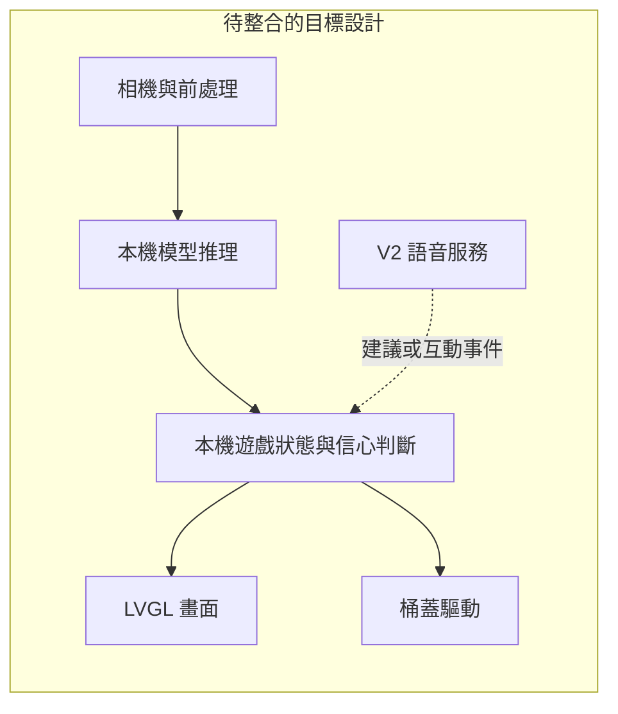

# 架構、入口與整合邊界

## 目前可執行的部分

這個 repository 是一組原型與研究專案，並非單一已整合的應用。每個 ESP-IDF 子專案各自建置；Arduino sketch、SDL 預覽與 Python 工具也有獨立入口。

| 層 | 來源／入口 | 責任與限制 |
| --- | --- | --- |
| 教育互動 UI | [LVGL](../ui/lvgl/README.md) | 顯示狀態、結果與學習內容；SDL fixture 不是相機或模型結果。 |
| 影像實驗 | [S3 probes](../firmware/esp32s3/README.md) | 量測特定模型和輸入；不是完整相機至開蓋控制器。 |
| 實體輸出測試 | [PCA9685](../firmware/esp32s3/pca9685_servo_test/README.md) | 四通道測試；同步寫入不證明機械開蓋到位。 |
| 語音／MCP | [自訂板型](../firmware/xiaozhi-esp32/main/boards/smart-trash-can/README.md) | 現有 GPIO9–12 控制；尚未接到 PCA9685。語音教育對話屬 V2。 |
| 板級 bring-up | [S31](../firmware/esp32s31/bringup/README.md) | 外設驗證骨架；仍有 codec、camera 與 SDK 驗證缺口。 |
| 資料與模型 | [工具](../tools/README.md)、[資料](../data/README.md)、[產物](../runs/README.md) | 主機側資料準備、量化與評估；模型產物必須保留資料來源、hash 及前處理對應。 |
| 設計與證據 | [設計來源](../design/README.md)、[報告](README.md) | 設計來源和測試紀錄分開；generated、ZIP、截圖均為衍生產物。 |

## 主要流程與下一個整合邊界

主要需求是影像分類教育遊戲；V2 增加 AI 語音互動。下圖是待整合的責任分工，並非已存在的 component API。



- 相機層負責影像格式、尺寸與 buffer 生命週期。
- 推理層回傳分類、信心與錯誤；模型路徑、輸入格式及分類順序須一致。
- 控制器持有遊戲狀態、分數、拒判與動作互鎖。UI 與語音不能直接切換任意 GPIO。
- 桶蓋層封裝直接 GPIO 或 PCA9685 的硬件差異；一次選定實際接線方案。應用不可同時佔用兩種配置。
- UI 只消費狀態與發出使用者事件。不能把示範 fixture 當成正式分類結果。

實作這些介面前，先確認目標板、相機、桶蓋接線與失敗行為，再逐步加入整合測試；不要一次搬動整個上游韌體。驗收條件見[系統決策](system-architecture-decision.md)。

## 目錄與來源規則

韌體來源集中於 `firmware/`：`esp32s31` 是目標板 bring-up，`xiaozhi-esp32` 保留上游框架邊界，`esp32s3` 與 `arduino` 是獨立實驗。`ui`、`design`、`tools`、`data`、`runs` 和 `docs` 各自保存顯示、設計、主機工具、資料、模型產物與證據。

搬移前四個韌體目錄位於 repository root。CMake 的 LVGL 預設來源、CI filters、開發 runner 與指南已隨之調整。歷史 JSON／log 中的模型路徑和雜湊保留原貌；它們描述當時的實驗，不是目前的操作命令。

本專案自有目錄與 `.github`、`.vscode` 均提供 `README.md`。生成資產、圖片與測試資料子目錄的指南交代來源及使用限制。`firmware/xiaozhi-esp32/` 是匯入的上游來源樹，沿用其 README 和 AGENTS；本專案自訂 smart-trash-can 板型整個子樹亦納入覆蓋與連結檢查。此例外不適用於根目錄的自有程式。

新增自有目錄時，指南至少說明用途、入口／產生來源及驗證方法；資料目錄則說明 provenance 和使用限制。從 repository root 執行：

```sh
python3 tools/check_docs.py
```

檢查會驗證 Git 追蹤目錄的 README 覆蓋，以及自有 Markdown 的行內相對檔案連結；不連網檢查 URL，也不驗證 reference-style 連結或 Markdown 錨點、內容真實性或硬件。
