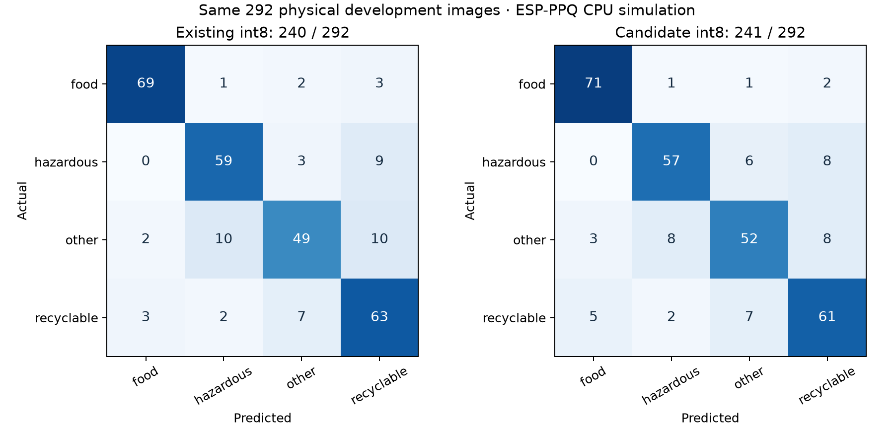

# 無額外文字卡面：YOLO／ESP-DL 開發比較

讀者：模型開發者、整合者及審查者。何時讀：使用此候選模型或比較結果前。這是開發實驗，**未有 S31 實機或獨立現場驗證**。

> **狀態：已被取代（2026-11-11）。** 本文描述嘅資料集同模型路徑已經刪除；現行模型同唯一資料來源係 [`models/wordless-padded/`](../../../../models/wordless-padded/README.md)。保留本文只作歷史記錄。

## 資料和模型

本次從現有 `mixed_s31` 對應的 YOLO11n-cls float32 權重繼續訓練。四類：food→廚餘桶 1、hazardous→有害桶 2、other→其他桶 3、recyclable→可回收桶 0。38 張白底卡沒有額外卡片名稱，但物件包裝本身的文字保留；B-11、B-14、B-15 經 AI 修整。來源及 hash 見當時的 `data/mixed-card-object/wordless-v1/README.md`（已刪除，只留 git 歷史）。

訓練使用 30 張卡產生的 **2,400 張合成卡片變體**，加 100 張真實物件訓練圖片（每張抽樣 5 次）。8 張數碼卡留作這次開發驗證，與本次訓練卡身份不重疊；但初始模型曾見過舊版相同身份，因此不能視作模型完全未見的獨立卡。沒有使用歷史 field-captures／field-probe 訓練、校準或選模型。

## 同資料比較：開發結果

| 模型與精度 | 輸入／數量 | 正確數 | 限制 |
|---|---|---:|---|
| 原混合 YOLO float32 | 同源真實物件開發集，292 張 | 245/292 | 與舊訓練資料同源，舊模型亦用過此開發集 |
| 新 YOLO float32，第 7 epoch | 同一組真實物件開發集，292 張 | 245/292 | 本次多個 checkpoint 根據此開發集比較 |
| 原混合模型 S31 int8 | 同一組真實物件開發集，292 張 | 240/292 | ESP-PPQ CPU 模擬，非板上推論 |
| 新候選 S31 int8 | 同一組真實物件開發集，292 張 | 241/292 | ESP-PPQ CPU 模擬，比舊 int8 多 1 張；不能證明現場表現改善 |
| 原及新 S31 int8 | 8 張留起的數碼卡，合成場景 | 各 8/8 | 只描述數碼卡情境；卡片身份曾被初始模型見過，不代表印刷卡準確率 |

比較使用相同來源圖與 `classify_transforms(160)`；這不是 S31 相機前處理一致性測試。[int8 混淆矩陣](physical-confusion-matrix.png) 的行是真實標籤、列是預測：新模型 food 正確數 69→71、hazardous 59→57、other 49→52、recyclable 63→61。總數略升，但有害與可回收類退步。

逐圖和矩陣：[舊 int8 實物 CSV](physical_baseline.csv)、[新 int8 實物 CSV](physical_candidate.csv)、[舊矩陣 JSON](physical_baseline.json)、[新矩陣 JSON](physical_candidate.json)、[新數碼卡 CSV](digital.csv)、[舊數碼卡 CSV](digital-baseline.csv)。[訓練紀錄](training-results.csv) 及 [checkpoint 比較](epoch-metrics.csv) 僅作開發記錄；開發集已用於選擇候選，不可再當獨立最終測試。

## 封面與卡背負面檢查

[三個數碼負面輸入及逐項結果](negative-controls/README.md)：現有 0.55 門檻下，新 int8 的封面仍以 0.901 誤判為 hazardous 並放行；新卡背 0.392 低於門檻。白圖是合成探測，不代表真實空鏡頭或印刷卡。韌體是否已實作門檻尚未確認，不能據此自動開蓋。

## 下一步

保留現行模型；當時的候選檔案在 `models/mixed-card-object/wordless-v1/`（已刪除，只留 git 歷史）。用不同實物、印刷卡、拍攝場次、手持與光線收集未參與開發的實拍測試；核對權利及來源。S31 相機前處理、int8 推理、RAM、延遲 p50/p95 和完整操作均未測。

方法參考：[Ultralytics 資料前處理與防止洩漏](https://docs.ultralytics.com/guides/preprocessing-annotated-data)；[Espressif ONNX 量化及 S31 目標](https://docs.espressif.com/projects/esp-dl/en/latest/tutorials/how_to_quantize_model.html)。
