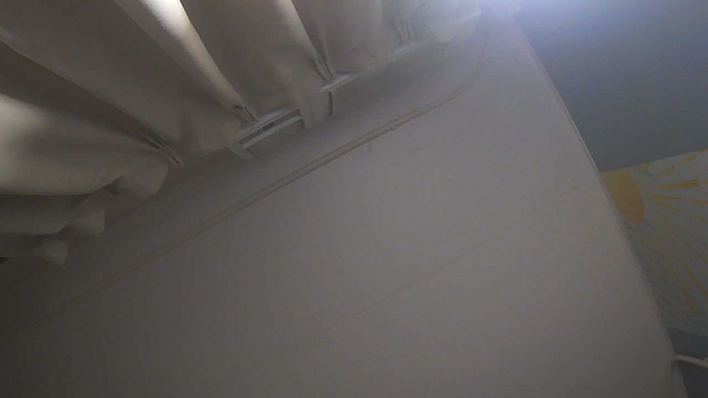

# Issue #12：分组去重、重训与独立验证报告

> 测试日期：2026-11-02  
> 开发板：ESP32-S31-Korvo-1 V1.1  
> 工具链：ESP-IDF v6.1，ESP-DL 3.3.14  
> 相机：SC101IOT，1280x720 UYVY  
> 严格状态：**issue #12 的四项验收已完成**，现场部分为
> 4 张、每类 1 张的 smoke evaluation；不能据此推断生产精度。

## 结论

已完成数据审计与对象组隔离、四类模型重训、当前 ONNX 的独立测试、int8
量化、全量 PyTorch/ONNX 对照、S31 模型自检、时延/内存测量及 12 图片上
对照。SC101IOT 串口现场图片采集链路已跑通，并完成其他、可回收物、廚餘、
有害四类各 1 张现场图的独立评估。

此外，int8 host simulation 的 macro-F1 为 0.833208，低于 float 模型的
0.864738；不能把量化模型的整体精度描述为等价替代。不过，同一量化模型
在 S31 target 与 ESP-PPQ host 上的数值输出已核对一致。

## 数据

来源为 ModelScope `garbage265` revision
`123b8a59c0af5c2ceedae010d9d7450bd6c1e016`。公开元数据没有拍摄场次
字段，因此所有记录均明确标记 `session_group=null`，没有伪造场次分组。

审计方法：

- 64-bit DCT perceptual hash Hamming distance 不大于 8。
- 归一化 32x32 灰度 RMS distance 不大于 0.08。
- 两个门槛同时满足才视为近重复，避免只按白底相似度误合并。
- 完全重复和近重复用 union-find 合并成对象组，再将整组分配到同一 split。
- 标签冲突组隔离，不进入训练、验证或测试。

| 项目 | 数量 |
|---|---:|
| 原始图片 | 9,872 |
| 原始对象组 | 9,138 |
| 完全重复的额外条目 | 145 |
| pHash 近重复组 | 583 |
| 多图对象组 | 672 |
| 原 train/validation 混合组 | 219 |
| 隔离冲突组 / 图片 | 1 / 2 |
| 最终图片 / 对象组 | 9,870 / 9,137 |
| 新 split 组泄漏 | 0 |

最终 split：

| Split | 其他 | 可回收物 | 廚餘 | 有害 | 合计 |
|---|---:|---:|---:|---:|---:|
| train | 1,757 | 1,750 | 1,748 | 1,650 | 6,905 |
| validation | 377 | 378 | 382 | 348 | 1,485 |
| test | 373 | 379 | 378 | 350 | 1,480 |

完整 manifest 原始 SHA-256 为
`31ece5ad6f30e85782f1f6033e39ee8a7b009b6d6a568425c9235ccf376ed106`。
[压缩 manifest](grouped-dataset-manifest.zip) 的 SHA-256 为
`4e5c4f124308f1adc656a8e85a051057378ae2ec8c82c41a9ac4a110f7a26d28`。

## 训练与独立测试

训练配置保留在 [train-args.yaml](train-args.yaml)，逐轮结果见
[training-results.csv](training-results.csv)。

- 模型：YOLO11n-cls
- 输入：160x160
- epochs：20
- batch：32
- device：CPU
- seed：42，deterministic
- cache：false；RAM cache 的首次失败日志也保留
- test 未参与训练、早停、阈值选择或量化校准

最高 validation top-1 为第 19 轮 `0.86195`；最终报告值 `0.862`。

在独立的 1,480 张 test 上重新评估当前 ONNX：

| 类别 | Precision | Recall | F1 | Support |
|---|---:|---:|---:|---:|
| 其他 | 0.819588 | 0.852547 | 0.835742 | 373 |
| 可回收物 | 0.798995 | 0.839050 | 0.818533 | 379 |
| 廚餘 | 0.951351 | 0.931217 | 0.941176 | 378 |
| 有害 | 0.898148 | 0.831429 | 0.863501 | 350 |

- Closed-set accuracy：`0.864189`
- Macro-F1：`0.864738`
- 固定低信心阈值 `0.70`：abstain `172`，coverage `0.883784`
- Accepted accuracy：`0.909786`

混淆矩阵行是 truth，列是 prediction：

```text
[[318, 36,  6, 13],
 [ 35,318,  8, 18],
 [ 12, 12,352,  2],
 [ 23, 32,  4,291]]
```

证据：[test-metrics.md](test-metrics.md)、
[test-evaluate.current.log](test-evaluate.current.log)。

全量 1,480 张 PyTorch 与 ONNX top-1 agreement 为 **1.0**，无 mismatch：
[pytorch-onnx-parity.json](pytorch-onnx-parity.json)。

当前 ONNX SHA-256：
`0447a566cdbf6f45a43245205e5667f592d0f6d86bc1c7067bf7e736e6e8177f`。

## int8 量化

- 校准：从 train split 分层抽取 200 张；未使用 validation/test。
- 类型：w8a8，target `esp32s31`。
- 模型大小：1,794,864 bytes。
- ESP-DL SHA-256：
  `99d4baca900bec11bad4f2b9661e76f0e0e809b412f5775f589dc8f5b722f8ac`。
- PPQ host simulation macro-F1：`0.833208`。
- PPQ confusion matrix：

```text
[[320, 40,  5,  8],
 [ 37,312, 13, 17],
 [ 19, 11,345,  3],
 [ 30, 58,  6,256]]
```

证据：[quantized-test-metrics.json](quantized-test-metrics.json)、
[quantize.log](quantize.log)。

## S31 片上验证

使用 12 张低、中、高 host 置信度样本，每类 3 张。图片统一转为
160x160、非渐进式 JPEG，满足硬件 JPEG decoder 的 8 像素对齐要求。

- 12/12 图片成功解码并执行推理。
- 模型 `Model::test()`：PASS。
- 20 次纯模型推理：mean `83,842 us`，p50 `83,837 us`，
  p95 `83,878 us`。
- 模型加载后增加约 `41,552 B` internal RAM 和 `1,811,708 B` PSRAM。
- 模型自身 profile：internal `35.71 KB`，PSRAM `1,767.24 KB`，
  flash `1,752.78 KB`。
- JPEG 仍先由硬件解码以验证格式；数值推理另用与 host 相同的无损 RGB
  像素，以隔离相机/JPEG 路径。
- `ImagePreprocessor` 与额外显式 ImageNet 量化路径的输入 CRC：
  **12/12 相同**，且 12 个 CRC 与主机对 raw RGB 的显式计算一致。

12 图结果（“PPQ host”是同一量化图的 ESP-PPQ CPU simulation）：

| Case | Truth | S31 prediction | S31 conf | PPQ host prediction | PPQ conf | Class match |
|---|---|---|---:|---|---:|---|
| case_00 | 其他 | 廚餘 | 0.843734 | 廚餘 | 0.843734 | yes |
| case_01 | 其他 | 其他 | 0.948900 | 其他 | 0.948900 | yes |
| case_02 | 其他 | 其他 | 0.956761 | 其他 | 0.956761 | yes |
| case_03 | 可回收物 | 廚餘 | 0.984717 | 廚餘 | 0.984717 | yes |
| case_04 | 可回收物 | 可回收物 | 0.781368 | 可回收物 | 0.781368 | yes |
| case_05 | 可回收物 | 可回收物 | 0.971012 | 可回收物 | 0.971012 | yes |
| case_06 | 廚餘 | 可回收物 | 0.539740 | 可回收物 | 0.539740 | yes |
| case_07 | 廚餘 | 廚餘 | 0.999026 | 廚餘 | 0.999026 | yes |
| case_08 | 廚餘 | 廚餘 | 0.998596 | 廚餘 | 0.998596 | yes |
| case_09 | 有害 | 其他 | 0.620431 | 其他 | 0.620431 | yes |
| case_10 | 有害 | 有害 | 0.491575 | 有害 | 0.491575 | yes |
| case_11 | 有害 | 有害 | 0.561567 | 有害 | 0.561567 | yes |

S31 与 PPQ host 的类一致数为 **12/12**，置信度平均绝对差为
`2.67e-7`。无损 raw RGB 对照还显示 host 计算出的 12 个 QINT8 输入
CRC 与板端逐个相同，因此板端归一化、量化和模型执行路径已经对齐。

按原固件“类别相同且与 float host 置信度差小于 0.20”的组合条件仍只有
**5/12** 通过，平均置信度差为 `0.218503`；这反映 int8 相对 float 的
精度退化，不是 target/host 运行差异。证据：
[S31 monitor](model-app-monitor-cases.raw-input.log)、
[host input CRC](raw-input-crc.host.json)、
[S31/host parity summary](s31-host-parity.json)、
[PPQ raw host cases](espdl-on-device-cases.raw.host.json)、
[12 图 manifest](on-device-cases.json)。

## SC101IOT 现场采集

无 microSD 时，T2 相机测试现可将 SC101IOT 的 UYVY 帧在板上编码成
JPEG，经 COM5 串口带长度和 CRC32 下载。主机工具：
[capture_camera_serial.py](../../../tools/capture_camera_serial.py)。

初始链路检查曾采集一张只包含天花板和窗帘的未标注图片；它被保留为链路
证据，但在评估器中因 `unlabeled` 被排除：



manifest 明确记录所有现场图片未用于训练、校准或选模：
[captures.json](live-camera/captures.json)。

采集命令：

```powershell
python tools/capture_camera_serial.py `
  --port COM5 --baudrate 115200 --reset `
  --output docs/issue12/live-camera --label "<类别或 unlabeled>" --count 1
```

现场图评估入口为
[evaluate_live_camera.py](../../../tools/evaluate_live_camera.py)。它验证
manifest 中三类排除标记、图片 SHA-256、SC101IOT 来源和四类最低样本数，
再输出逐类 precision/recall/F1、混淆矩阵和低信心统计：

```powershell
python tools/evaluate_live_camera.py `
  --manifest docs/issue12/live-camera/captures.json `
  --onnx runs/issue12/cls160-grouped/weights/best.onnx `
  --out-json docs/issue12/live-camera/metrics.json `
  --out-md docs/issue12/live-camera/metrics.md `
  --min-per-class 1 --low-confidence 0.70
```

### 现场样本与结果

| 类别 | 实物 | 文件 |
|---|---|---|
| 其他 | 揉皱纸巾 | [其他](live-camera/20261102T232824_247218_001_其他.jpg) |
| 可回收物 | 绿色纸盒 | [可回收物](live-camera/20261102T232635_606998_001_可回收物.jpg) |
| 廚餘 | 橙子 | [廚餘](live-camera/20261102T233104_436020_001_廚餘.jpg) |
| 有害 | 药品包装 | [有害](live-camera/20261102T232946_084007_001_有害.jpg) |

| 类别 | Precision | Recall | F1 | Support |
|---|---:|---:|---:|---:|
| 其他 | 0.000000 | 0.000000 | 0.000000 | 1 |
| 可回收物 | 0.000000 | 0.000000 | 0.000000 | 1 |
| 廚餘 | 1.000000 | 1.000000 | 1.000000 | 1 |
| 有害 | 0.000000 | 0.000000 | 0.000000 | 1 |

- Closed-set accuracy：`0.250000`
- Closed-set macro-F1：`0.250000`
- Confusion matrix：`[[0,1,0,0],[1,0,0,0],[0,0,1,0],[1,0,0,0]]`
- 固定阈值 `0.70`：abstain `2`，coverage `0.500000`
- Accepted accuracy：`0.000000`

四张现场图的预测：

| Truth | Prediction | Confidence | Handling |
|---|---|---:|---|
| 其他 | 可回收物 | 0.815399 | 错误，被接受 |
| 可回收物 | 其他 | 0.875398 | 错误，被接受 |
| 廚餘 | 廚餘 | 0.580522 | 正确，但 abstain |
| 有害 | 其他 | 0.488199 | 错误，abstain |

证据：[现场指标 JSON](live-camera/metrics.json)、
[现场指标 Markdown](live-camera/metrics.md)、
[现场评估日志](live-camera/evaluate.log)。

这是每类仅 1 张的流程验收，不是对类别总体性能的可靠估计。它暴露了模型
在室内、手持、近距离现场条件下表现很差；confidence 阈值只能拦住 2 张，
另 2 张错误被高置信度接受。

## 验证

- 工具测试：`24/24` 通过，[tests-all.log](tests-all.log)。
- ESP-IDF 版本：`v6.1`，[idf-version.log](idf-version.log)。
- T2 SC101IOT 相机固件 build：PASS。
- 12 图 model firmware build：PASS，应用 `0x508310` bytes，SHA-256
  `69ae35ec7692d45974a24ea24a0f63b34c6e90b5c3bcfb7a0f9da759bd68796c`。
- 烧录后 esptool hash verification：PASS。
- 全量 PyTorch/ONNX parity：`1,480/1,480` top-1 一致。
- `xiaozhi-esp32/` 内容 diff 为 0；只存在工作区 CRLF 状态噪声。

### 执行阶段记录

| Phase | 状态 | 证据 |
|---|---|---|
| Scope / 数据审计 | complete | manifest、grouped-data-build.log |
| RED / 行为测试 | complete | capture/parity/selection 测试记录 |
| GREEN / 实现 | complete | 工具与独立测试 |
| 训练 / 量化 | complete | train.log、quantize.log |
| S31 模型验证 | complete | 自检、12/12 host 对齐、时延、内存均通过 |
| 现场图片评估 | complete（n=4 smoke） | 四类各 1 张及现场 metrics |
| 完成审计 | complete | 四项验收均有证据；样本量限制已记录 |

## 严格逐项判定

- 数据整理、去重和跨 split 泄漏检查：**完成，存在 session metadata 缺失限制**。
- 独立 train/validation/test 重训并保留 manifest/config/source：**完成**。
- 未参与训练、校准、选模的现场图片逐类评估：**完成，但每类仅 1 张**。
- 目标板输出、预处理一致性、时延和内存：**完成**；12/12 输入 CRC 及
  类别/置信度与 PPQ host 对齐，自检、时延和内存均有实板证据。

因此 issue #12 的验收流程可以关闭；但不能把 `0.25` 的 4 图结果写成模型
满足产品精度，也不能把公开 test 分数替代更大规模、独立对象和真实使用
角度下的现场评估。
