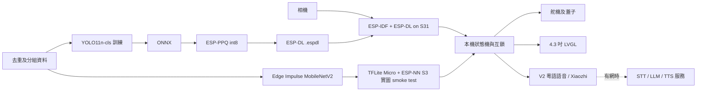

# 系統架構決定與驗收

## 決定

採用 ESP-IDF 作主控制框架，LVGL 9.5 作 4.3 吋介面。980 張共享去重測試的 host macro-F1 偏向 YOLO11n-cls：ONNX 0.862707、ESP-PPQ int8 simulation 0.858549；EI MobileNetV2 int8 TFLite 為 0.805371。故把 YOLO ONNX → ESP-PPQ `.espdl` 列為 S31 首選驗證候選。EI v1 `.tflite` 經 S3/TFLM + ESP-NN 以四張選定實圖各執行 20 次，最後輸出皆符合標籤；各張 Invoke p95 為 858.141–858.196 ms，須擴大實板樣本後再選定。這是準確率候選決定，不是產品定案：YOLO 尚未在 S31 執行；S3 專用 ESP-DL 模型已以四張選定實圖完成 smoke test，不能當成準確率估計。S31 的 TFLM/IDF 6.1 配對仍須 build；EON v2 C++ 尚未與 Espressif runtime 整合。以本機狀態機決定開蓋、低信心處理及安全互鎖；Wi-Fi、語音服務與 LLM 不在拍照到開蓋的必要路徑。三秒整機 p95、屏幕、斷網與十次循環均未驗證。

V2 必須提供粵語語音、鼓勵說話和小智式自由對話。沿用本倉庫 Xiaozhi 作語音介面原型；分類與安全控制由本機狀態機承擔。其已有音訊、傳輸和 MCP 工具；先驗證與現有 LVGL 畫面、S31 板型及資源的整合，再決定是否合併整份韌體或只用相容的語音協定。ESP-IDF 版本需按目標板核對：上游 Xiaozhi 說 S31 使用 IDF 6.1 以上；目前 S3 probe 用 6.0.2，兩者不可直接視作相容。

## 建議架構

## V2 必要語音分層

- 斷網基本功能：觸控或按鍵啟動、裝置端分類與本地開蓋；以預錄提示音作離線語音輸出。這條路不依靠 STT、TTS 伺服器或 LLM。
- 可選離線命令：評估 ESP-SR WakeNet / MultiNet，但官方文件明確描述中文與英文命令，粵語識別、S31 版本及與視覺任務的資源競爭均未驗證；觸控仍是基準入口。
- 必要的自由對話：XiaoZhi 相容音訊串流至 ASR → LLM → TTS。`xiaozhi.me` 公開頁說明串流架構，但沒有公開託管服務實際 ASR/TTS provider。粵語原型採 Xunfei streaming ASR（`language=zh_cn`、`domain=xfime-mianqie`、`accent=cantonese`）及 Qwen Flash；Xunfei 方言需取得權限。TTS 試 `zh-HK-HiuGaaiNeural` 或 `zh-HK-WanLungNeural`，並驗證自架 server adapter 的粵語輸出及延遲。無網絡時明確提示自由對話不可用，不應阻塞分桶。
- LLM 建議只提供解說或建議；硬件動作須經本機白名單、狀態檢查與互鎖。不要讓模型輸出直接決定任意 GPIO 或覆蓋本機分類。

## 驗收定義

| 項目 | 證據與通過條件 | 現況 |
|---|---|---|
| 影相→判類→開蓋 | 在實際裝配下由拍照觸發到蓋子達到開啟位置計時；逐次記 capture、預處理、推理、決策、馬達及總時間；總 p95 ≤ 3000 ms | S3 模型 Invoke p95 858.635 ms；全流程未測，S31 未測 |
| 4.3 吋屏幕 | 目標顯示屏實機能顯示流程與操作；確認觸控、可讀性和狀態更新 | 既有 LVGL 主機預覽；實屏未驗證 |
| 斷網可用 | 關閉 Wi-Fi 和外部伺服器後，完整分桶路徑及本地提示仍可用 | 未驗證 |
| 連續 10 次 | 10 次連續操作皆能完成正確分類及對應蓋子動作，記錄失敗、重啟和結果 | 未驗證 |

10 次樣本採 nearest-rank p95 時等於最大值；用更多次數估計穩定的 p95，並保留原始時間及環境。舵機命令發出時間不能代表蓋子已開到位；需要位置感測或外部影片等可觀察證據。失敗和超時要保留於結果，不能從 p95 或連續成功次數中隱藏。

## 依據

- [現有 Xiaozhi firmware](https://github.com/78/xiaozhi-esp32)：ESP-IDF 版本、離線喚醒、傳輸及語音串流。
- [Espressif ESP-SR command recognition](https://docs.espressif.com/projects/esp-sr/en/latest/esp32s3/speech_command_recognition/README.html)：S3 的離線命令支援及限制；並非 S31／粵語驗證。
- [Espressif esp_xiaozhi component](https://github.com/espressif/esp-iot-solution/tree/master/components/esp_xiaozhi)：語音串流及 MCP 架構。
- [ESP32-S31-Korvo-1 硬件](https://docs.espressif.com/projects/esp-dev-kits/en/latest/esp32s31/esp32-s31-korvo-1/index.html)：4.3 吋子板及音訊／相機配置，僅適用此板，不能代替實際板型辨認。

## CV 訓練決定

首版以單件物品、固定拍攝區域的四類影像分類為目標，保留 MobileNetV2 0.5 與 YOLO11n-cls 兩條模型線，輸入 160×160 RGB、int8。共享去重 test 顯示 YOLO 分數較高，因此先在 S31 build、實圖推理與 latency 驗證 YOLO `.espdl`；EI TFLite 的 S3 四張實圖 smoke test 已通過，仍需擴大樣本。再按真實桶內相機、光線、背景、遮擋及香港分類規則補充資料；以物件、場次和場景分組 train / validation / test，先去完全重複並檢查近重複。對低信心、非四類、多件或無物品提供人工選擇，不自動硬判。只有需求變成同時定位多個物品時，才加 bounding-box 標註並比較 detection。現有公開資料不能代表現場所有垃圾。

V2 的主要互動是 4.3 吋屏幕上的動畫、分類結果、實際分數及完成後「了解更多」；語音與屏幕事件同步。詳細內容、離線退化及供應商證據見 `v2-voice-screen.md`。
