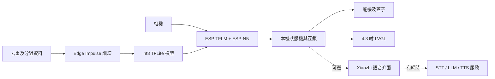

# 系統架構決定與驗收

## 決定

採用 ESP-IDF 作主控制框架，LVGL 9.5 作 4.3 吋介面，Edge Impulse MobileNetV2 int8 作首個影像分類原型，經 TFLite Micro / ESP-NN 在裝置執行。以本機狀態機決定開蓋、處理低信心及錯誤；Wi-Fi、語音服務與 LLM 不在拍照到開蓋的必要路徑。這是原型決策，未證明 3 秒目標、準確率或 S31 算子相容性。

沿用本倉庫 Xiaozhi 作可選語音介面原型，而不是以它作分類與安全控制的唯一入口。其已有音訊、傳輸和 MCP 工具；先驗證與現有 LVGL 畫面、S31 板型及資源的整合，再決定是否合併整份韌體或只用相容的語音協定。ESP-IDF 版本需按目標板核對：上游 Xiaozhi 說 S31 使用 IDF 6.1 以上；目前 S3 probe 用 6.0.2，兩者不可直接視作相容。

## 建議架構

## 語音分層

- 斷網基本功能：觸控或按鍵啟動、裝置端分類與本地開蓋；以預錄提示音作離線語音輸出。這條路不依靠 STT、TTS 伺服器或 LLM。
- 可選離線命令：評估 ESP-SR WakeNet / MultiNet，但官方文件明確描述中文與英文命令，粵語識別、S31 版本及與視覺任務的資源競爭均未驗證；觸控仍是基準入口。
- 可選自由對話：Xiaozhi 音訊串流至服務端 STT → LLM → TTS。可先評估支援粵語的 SenseVoice 與服務端 TTS；模型授權、兒童粵語、網絡中斷和實際延遲必須另行驗證。無網絡時明確提示對話不可用，不應阻塞分桶。
- LLM 建議只提供解說或建議；硬件動作須經本機白名單、狀態檢查與互鎖。不要讓模型輸出直接決定任意 GPIO 或覆蓋本機分類。

## 驗收定義

| 項目 | 證據與通過條件 | 現況 |
|---|---|---|
| 影相→判類→開蓋 | 在實際裝配下由拍照觸發到蓋子達到開啟位置計時；逐次記 capture、預處理、推理、決策、馬達及總時間；總 p95 ≤ 3000 ms | 未測；Studio 預估不是實測 |
| 4.3 吋屏幕 | 目標顯示屏實機能顯示流程與操作；確認觸控、可讀性和狀態更新 | 既有 LVGL 主機預覽；實屏未驗證 |
| 斷網可用 | 關閉 Wi-Fi 和外部伺服器後，完整分桶路徑及本地提示仍可用 | 未驗證 |
| 連續 10 次 | 10 次連續操作皆能完成正確分類及對應蓋子動作，記錄失敗、重啟和結果 | 未驗證 |

10 次樣本採 nearest-rank p95 時等於最大值；用更多次數估計穩定的 p95，並保留原始時間及環境。舵機命令發出時間不能代表蓋子已開到位；需要位置感測或外部影片等可觀察證據。失敗和超時要保留於結果，不能從 p95 或連續成功次數中隱藏。

## 依據

- [現有 Xiaozhi firmware](https://github.com/78/xiaozhi-esp32)：ESP-IDF 版本、離線喚醒、傳輸及語音串流。
- [Espressif ESP-SR command recognition](https://docs.espressif.com/projects/esp-sr/en/latest/esp32s3/speech_command_recognition/README.html)：S3 的離線命令支援及限制；並非 S31／粵語驗證。
- [Espressif esp_xiaozhi component](https://github.com/espressif/esp-iot-solution/tree/master/components/esp_xiaozhi)：語音串流及 MCP 架構。
- [ESP32-S31-Korvo-1 硬件](https://docs.espressif.com/projects/esp-dev-kits/en/latest/esp32s31/esp32-s31-korvo-1/index.html)：4.3 吋子板及音訊／相機配置，僅適用此板，不能代替實際板型辨認。

## CV 訓練決定

首版以單件物品、固定拍攝區域的四類影像分類為目標，選 MobileNetV2 0.5 transfer learning、160×160 RGB 與 int8。按真實垃圾桶相機位置、光線、背景、遮擋及香港分類規則收集資料；保留未見過的物品、拍攝場次和場景，按來源群組分配 train / validation / test，並先去除完全重複及檢查近重複。對低信心、非四類、多件或無物品提供人工選擇，不自動硬判。若需求變為同時定位多個物品，需另行收集 bounding box 標註並比較偵測模型；目前分類模型不能提供位置。現有公開資料只涵蓋每大類五個細類，不能代表現場所有垃圾。
