# Figma 設計 vs LVGL 實際渲染（800×480）

讀者：改 UI 的人、審 design token／layout 的人、要在實機前確認畫面對不對的人。
何時讀：改 `ui/lvgl/`、改 `design/*.json`、或懷疑 Figma 與畫面走樣時。

本文件只比較**實際 framebuffer** 與**設計來源**，不推定硬件、觸控、相機、推理或舵機行為。
設計來源：`design/tokens.json`、`design/layout.json`、`design/spacing-policy.json`、`design/issue-3-sync.json`、`design/issue-3.md`、`ui/lvgl/README.md`（決策紀錄）、`AGENTS.md` §6。

## 一句話結論

畫布、色票、字級、24 px 安全邊、底列 400/64 幾何在九個狀態全部對得上；
**真正走樣的是三件事**：`result_ok` 的角落「完成」按鈕、`category_guide`／`learning` 的底列結構（與 `design/layout.json` 及 `design/issue-3.md` 互相矛盾）、
以及 `classifying` 七階段列其實無法顯示真實進度（payload 沒有 phase 欄位）。

## 方法與環境

- 原生 SDL 預覽，800×480、rotation 0、RGB565、LVGL 9.5.0，軟件 renderer（`SDL_RENDER_DRIVER=software`）。
- 截圖由既有管線產生：`ui/lvgl/tools/capture.py` 呼叫 `bin/main --screenshots`，BMP→PNG，並另出兩張 contact sheet。
- 幾何與色值比較以程式量測：PNG 尺寸、填充色 mode、文字 ink bbox、色票反投影。
- **本次 17 張 framebuffer PNG 的 SHA-256 與 `ui/lvgl/preview/render/render-manifest.json` 逐張相同**，即 repo 內的截圖就是這次 build 的輸出，沒有舊圖混入。
- 所有畫面都能直接 render，**沒有改動任何 `ui/lvgl/` 代碼**（無需補註冊、無 crash、無尺寸修正）；`stc_ui_check_layout` 在九個狀態與所有變體都 PASS。

```sh
# LVGL 9.5 放在本機快取，managed component 不在這個 checkout
cmake -S ui/lvgl/preview -B /tmp/stc-ui-build -G Ninja -DCMAKE_BUILD_TYPE=Debug \
  -DLVGL_DIR=/tmp/lvgl-9.5                       # Configured / Generating done
cmake --build /tmp/stc-ui-build --parallel 8      # 545/545，link 成功
ctest --test-dir /tmp/stc-ui-build --output-on-failure
#   1/1 Test #1: state_and_layout ... Passed    100% tests passed, 0 failed
SDL_VIDEODRIVER=dummy SDL_RENDER_DRIVER=software ui/lvgl/preview/bin/main
#   印出 DEMO 800x480 RGB565 rotation=0 並持續 render（4 s timeout 後結束）
ui/lvgl/tools/.venv/bin/python ui/lvgl/tools/capture.py
#   PASS native RGB565 framebuffer captures: nine states, all four results/lessons, uint32 boundary screens.
```

> 顏色差異說明：token `#F0F4EF` 在 RGB565 下存成 5-6-5 位，展回 8 位後量到 `#F7F7EF`。這是量化，不是設計偏差；反投影後**所有填充色與 token 的通道差為 0**。token 與其 RGB565 展回值最多差 7/通道（例如 brand `#153B2C` → `#103829`）。

## 覆蓋清單

app 狀態機（`app/stc_app.c` 的 `map_phase`）只會送出 9 個 `stc_ui_state_t`；對應截圖如下。

| # | 狀態／變體 | 截圖 | 觸發來源 |
|---|---|---|---|
| 1 | idle | [idle.png](../../ui/lvgl/preview/render/idle.png) | `STC_PH_IDLE`／`STC_PH_PROMPT` |
| 2 | capturing | [capturing.png](../../ui/lvgl/preview/render/capturing.png) | `STC_PH_SCAN` |
| 3 | classifying | [classifying.png](../../ui/lvgl/preview/render/classifying.png) | `STC_PH_RESULT`（非 abstain） |
| 4 | result_ok（cat0） | [result_ok.png](../../ui/lvgl/preview/render/result_ok.png) | `STC_PH_OPEN`／`WAIT_DROP`／`SETTLE`／`CLOSE` |
| 5 | result_ok（cat1–3） | [result-cat-1](../../ui/lvgl/preview/render/result-cat-1.png) · [cat-2](../../ui/lvgl/preview/render/result-cat-2.png) · [cat-3](../../ui/lvgl/preview/render/result-cat-3.png) | 同上，四類 |
| 6 | result_retry | [result_retry.png](../../ui/lvgl/preview/render/result_retry.png) | `STC_PH_RESULT`（abstain） |
| 7 | error | [error.png](../../ui/lvgl/preview/render/error.png) | 任何無效轉移／`error_code` |
| 8 | category_guide | [category_guide.png](../../ui/lvgl/preview/render/category_guide.png) | 完成後進入 |
| 9 | learning（cat0） | [learning.png](../../ui/lvgl/preview/render/learning.png) | `STC_PH_LEARNING` |
| 10 | learning（cat1–3） | [cat-1](../../ui/lvgl/preview/render/learning-cat-1.png) · [cat-2](../../ui/lvgl/preview/render/learning-cat-2.png) · [cat-3](../../ui/lvgl/preview/render/learning-cat-3.png) | 四類 |
| 11 | summary | [summary.png](../../ui/lvgl/preview/render/summary.png) | `STC_PH_SUMMARY` |
| 12 | uint32 邊界（result／summary） | [result-max](../../ui/lvgl/preview/render/result-max.png) · [summary-max](../../ui/lvgl/preview/render/summary-max.png) | fixture `UINT32_MAX` |

總覽：[overview.png](../../ui/lvgl/preview/render/overview.png)（九狀態）· [categories.png](../../ui/lvgl/preview/render/categories.png)（四類結果／小百科）。

## 共通量測

| 規則 | 來源 | 量測結果 | 判定 |
|---|---|---|---|
| 畫布 800×480、rotation 0 | `design/layout.json`、`ui/lvgl/README.md` | 17 張 framebuffer PNG 全部 800×480；每屏根節點 0,0,800×480 | 一致 |
| 底欄 24 px 內距 | `spacing-policy.json` `outer_x` | 除全寬頂欄／底色外，九屏內容節點 min x = 24、max x+w = 776 | 一致 |
| 頂欄 72 px 全寬 brand | `layout.json` `comp/topbar` | 每屏第 0–71 列為 brand；第 72 列起為 bg | 一致 |
| 底列 y=400、高 64 | `spacing-policy.json` `footer_y`／`footer_height` | 九屏全部 `y=400, h=64`，底邊 464（距畫面底 16） | 一致 |
| 色票 | `tokens.json` | 反投影後填充色與 token 通道差 = 0 | 一致 |
| 字級 112／80／56／32／26 | `tokens.json` `font` | 生成節點與設計 JSON 的 `font` 完全相同 | 一致 |
| 文字不溢出節點 | `validate_design.py`、`check_layout` | 全部 text ink 都在節點框內（overflow 0 px） | 一致 |
| 主按鈕全寬貼底 | `AGENTS.md` §6 | idle／error／learning 752×64 ✓；`result_ok` 只有角落 128×48 按鈕 | **偏差** |
| 按鈕圓角 16 | `tokens.json` `radius.card` | 渲染 16；但 `layout.json` 的 button 節點**沒有 radius 欄位** | 資料缺口 |
| 24 px 安全邊 | `AGENTS.md`、`ui-visual-quality.md` §4 | 靜態幾何 ✓；`category_guide` 首張卡的鍵盤焦點外框畫到 x=21（越界 3 px） | **偏差（僅焦點狀態）** |

## 逐屏比較

### 1. idle（Figma `state/idle`，node 5:36）

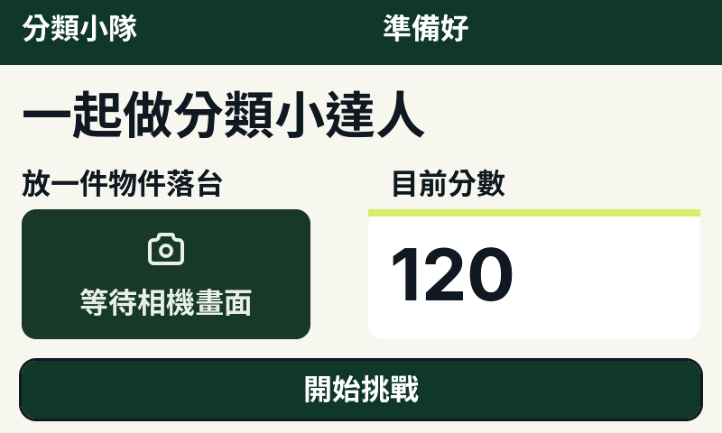

| 項目 | 設計值 | LVGL 實測 | 差異 | 判定 |
|---|---|---|---|---|
| 頂欄／brand／status | 0,0 800×72；24,12 352×48；424,12 352×48 | 同 | 0 | 一致 |
| prompt（56 px） | 24,96 752×80 | 文字 ink 100–153 | 0 | 一致 |
| hint（32 px） | 24,184 352×48 | 同 | 0 | 一致 |
| 相機佔位 | 24,232 320×144 | 同 | 0 | 一致 |
| 分數卡＋accent 8 px | 408,232 368×144；accent 368×8 | 同 | 0 | 一致 |
| 分數 80 px「120」 | 432,256 320×96 | ink 435–567 × 274–333，框內 | 0 | 一致（fixture 值，`README` 講啟動為 0） |
| 主按鈕 | 24,400 752×64 | 同；文字居中 | 0 | 一致，符合 AGENTS |
| 按鈕圓角 | layout.json 無 radius | 渲染 16 | 16 px | 資料缺口（生成器預設） |

### 2. capturing（`state/capturing`，5:51）

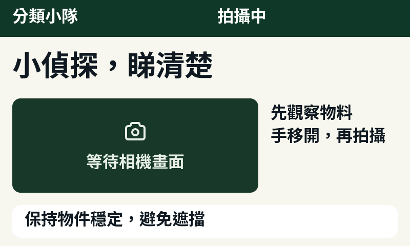

| 項目 | 設計值 | LVGL 實測 | 差異 | 判定 |
|---|---|---|---|---|
| prompt 56 px | 24,96 752×80 | 同 | 0 | 一致 |
| 相機 480×184 | 24,192 | 同 | 0 | 一致 |
| hint 兩行 32 px | 528,200 248×96 | 兩行，ink 高 79 px | 0 | 一致 |
| 底部提示列 | 24,400 752×64 surface r16 | 同；文字內距 24,8 | 0 | 一致 |

此屏與 `layout.json` 完全一致，只差 RGB565 量化。

### 3. classifying（`state/classifying`，5:64）

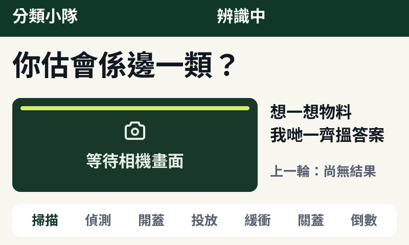

| 項目 | 設計值 | LVGL 實測 | 差異 | 判定 |
|---|---|---|---|---|
| prompt／相機／hint／`previous` | 24,96；24,192 480×184；528,200；528,320 248×40（26 px muted） | 同 | 0 | 一致 |
| 掃描光條 | 40,208 448×8 accent r16 | 同，透明度動畫 260 ms | 0 | 一致 |
| 底列內容 | `comp/instruction` + 文字「本輪完成後會顯示分類」（內距 24,8） | `comp/round-phases` + 7 個階段標籤（掃描／偵測／開蓋／投放／緩衝／關蓋／倒數） | 結構整個換掉；文字內距 24→16（**−8 px**） | **偏差（決策已改，JSON 未跟）** |
| 階段列幾何 | 無 | 7×96×32，y=416，x=40+104i，標籤間距 8 | 新增 | 決策文件一致（`ui/lvgl/README.md`） |
| 目前階段高亮 | 無 | `phase/0` 用 brand，其餘 `fg_muted`，**永不變**（payload 無 phase 欄位） | 靜態假進度 | **偏差（功能）** |

### 4. result_ok（`state/result_ok`，5:79）

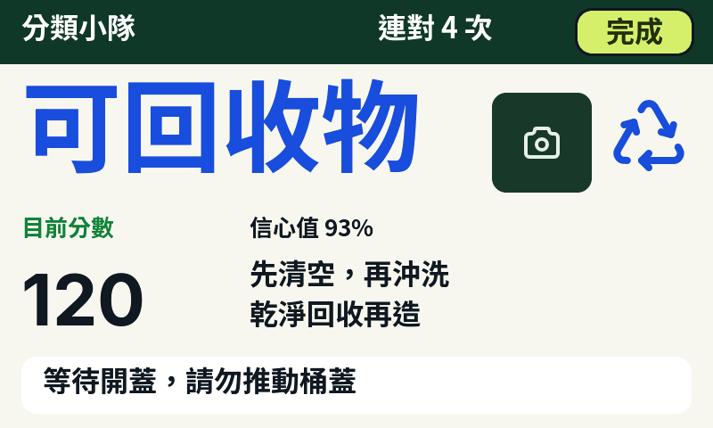

| 項目 | 設計值 | LVGL 實測 | 差異 | 判定 |
|---|---|---|---|---|
| 類別 112 px | 24,80 512×144 | 4 字 ink 寬 439，框內 | 0 | 一致 |
| 類別圖示 96×96 | 680,104 | 同 | 0 | 一致 |
| 物件縮圖 112×112 | 552,104 | 同 | 0 | 一致 |
| 縮圖→類別圖示間距 | 640→656 | 16 px | `icon_gap` 24 → **−8 px** | 輕微偏差 |
| confidence 26 px | 280,240 496×40 | 同 | 0 | 一致 |
| 「目前分數」26 px（ok 綠） | 24,240 232×40 | 同 | 0 | 一致 |
| 分數 80 px | 24,288 232×96 | 同 | 0 | 一致 |
| tip 兩行 32 px | 280,288 496×96 | 同 | 0 | 一致 |
| 底部提示列 | 24,400 752×64 | 同 | 0 | 一致 |
| 「完成」按鈕 | 648,12 **128×48** accent r16 | 同（ink 648–775 / 12–59） | 對比全寬 752×64：**−624 寬、−16 高** | **偏差（AGENTS：不可角落按鈕）** |
| 按鈕焦點外框 | Figma 無此狀態 | 3 px `fg` 外框畫在按鈕**外側**（左側 x=645–647），開屏即出現 | 新增 3 px | **偏差** |
| status 與按鈕 | status 424..648；按鈕 648 起 | 最大連對時 ink 424–647 | 間距 **0 px** | 邊界風險 |

### 5. result_retry（`state/result_retry`，5:98）

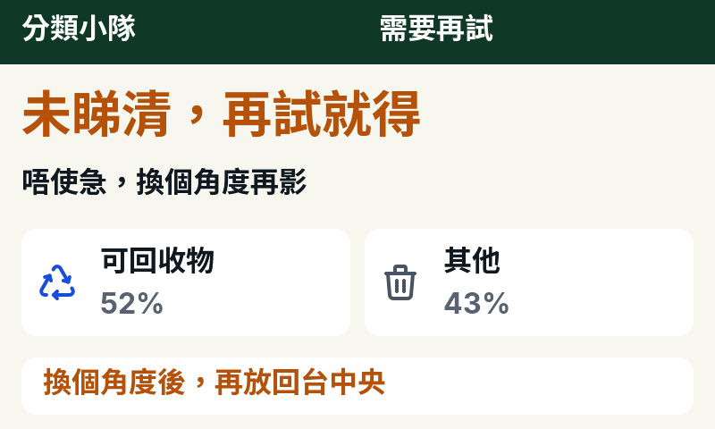

| 項目 | 設計值 | LVGL 實測 | 差異 | 判定 |
|---|---|---|---|---|
| prompt 56 px（warn） | 24,96 752×80 | 同 | 0 | 一致 |
| hint 32 px | 24,184 752×48 | 同 | 0 | 一致 |
| 兩張候選卡 | 24,256／408,256 368×120 surface r16 | 同 | 0 | 一致 |
| 卡內 icon／文字／機率 | icon 48 at +16,+36；文字 x=+88；機率 y=+64 | 同，icon 至文字 24 px | 0 | 一致 |
| 底部提示列 | 24,400 752×64，文字 warn | 同 | 0 | 一致 |
| 可按的操作 | 無按鈕 | 無按鈕 | 0（與 Figma 一致） | **UX 偏差**：本屏冇主行動，重試只能靠控制程式／換角度 |

### 6. error（`state/error`，5:127）

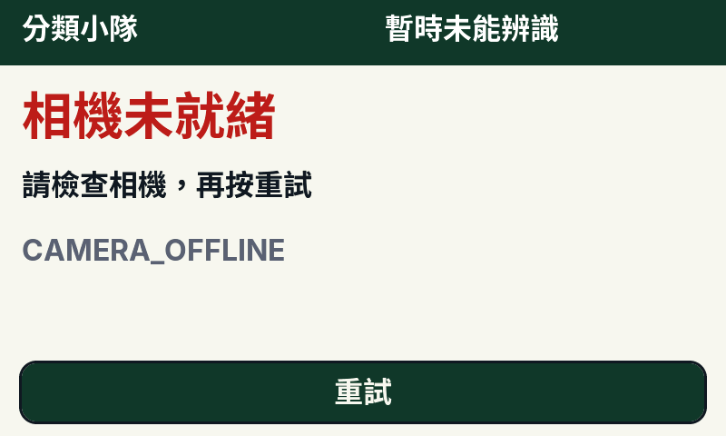

| 項目 | 設計值 | LVGL 實測 | 差異 | 判定 |
|---|---|---|---|---|
| prompt 56 px（error 紅） | 24,96 752×80 | 同 | 0 | 一致 |
| hint 32 px | 24,184 752×48 | 同 | 0 | 一致 |
| error code 32 px muted | 24,256 752×48 | 同（ASCII 過濾） | 0 | 一致 |
| 重試按鈕 | 24,400 752×64，fg=`bg` | 同 | 0 | 一致，符合 AGENTS |
| 文案變體 | JSON 只有「相機未就緒／請檢查相機」 | code 另有 `NETWORK_OFFLINE`「連線中斷」與預設「暫時未能辨識」 | 文字由 UI 決定，JSON 無此資料 | 資料缺口 |

### 7. category_guide（`state/category_guide`，9:75）

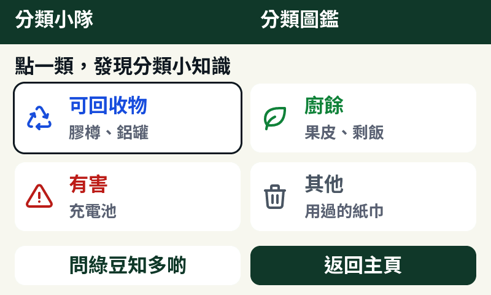

| 項目 | 設計值 | LVGL 實測 | 差異 | 判定 |
|---|---|---|---|---|
| prompt 32 px | 24,88 752×40 | 同 | 0 | 一致 |
| 四張分類卡 | 368×112，y=136／264，x=24／408，間距 16 | 同 | 0 | 一致 |
| 卡內 icon→文字 | icon 48 at x=40；文字 x=112 | 24 px | 0 | 一致 |
| 類別名 32 px／例子 26 px | y=152／200（下排 280／328） | 同 | 0 | 一致 |
| 底列左鍵 | `action/finish`「返回成績」368×64 surface | `action/ask`「問綠豆知多啲」同尺寸 | 文案＋行為換掉；幾何 0 | **偏差（且與 `design/issue-3.md` L54／L293 矛盾）** |
| 底列右鍵 | `action/home`「返回主頁」368×64 brand | 同 | 0 | 一致 |
| 首張卡焦點框 | Figma 無 | 3 px 外框在 x=21–23／y=133–135／右 392–394／底 248–250 | 越過 24 px 安全邊 **3 px** | **偏差** |
| 主行動是否全寬 | AGENTS 要求全寬貼底 | 兩粒半寬 368 | 主行動寬度 **−384 px** | 偏差（規則 vs 版面設計衝突） |

### 8. learning（`state/learning`，9:179）

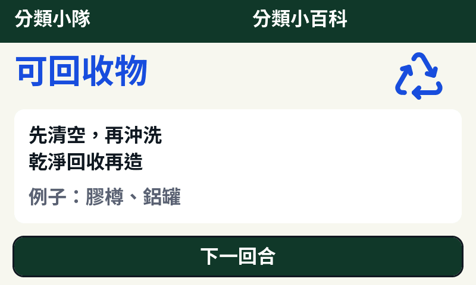

| 項目 | 設計值 | LVGL 實測 | 差異 | 判定 |
|---|---|---|---|---|
| 類別 56 px | 24,88 624×80 | 同 | 0 | 一致 |
| 類別圖示 96×96 | 656,80 | 同 | 0 | 一致 |
| 教材卡 | 24,184 752×192 surface r16 | 同 | 0 | 一致 |
| tip 兩行 32 px | 48,208 704×96（卡內 24） | 同 | 0 | 一致 |
| example 32 px | 48,312 704×40（卡內 128） | 同；`例子：…` 前綴 | 0 | 一致 |
| 底列 | `action/guide`「返回圖鑑」＋`action/home`「返回主頁」，各 368×64 | 單粒 `action/start`「下一回合」752×64 | 少一粒、寬 **+384 px** | **偏差（決策已改，JSON／issue 未跟）** |

### 9. summary（`state/summary`，9:148）

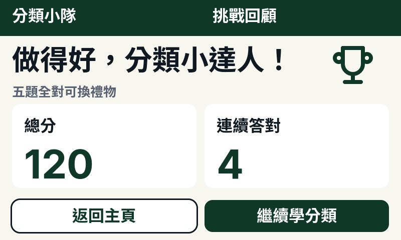

| 項目 | 設計值 | LVGL 實測 | 差異 | 判定 |
|---|---|---|---|---|
| prompt 56 px | 24,88 624×80 | 同 | 0 | 一致 |
| 獎盃 96×96 | 656,80 | 同 | 0 | 一致 |
| 「五題全對可換禮物」26 px | **layout.json 無此節點** | 24,168 624×36 | 新增；與 prompt 框距 0、與卡片框距 4 px | **新增＋間距偏差**（`text_gap` 8／`section_gap` 16） |
| 兩張分數卡 | 24,184／408,184 **368×192** | 24,208／408,208 **368×168** | y **+24**、高 **−24** | **偏差** |
| 卡內標籤（32 px） | 卡內 y=24（+24） | 卡+24 | 0 | 一致 |
| 卡內數值（80 px） | 卡內 y=72，高 96 → 底距 24 | 卡+72，高 96 → **底距 0** | **−24 px** | **偏差** |
| 底列 | 返回主頁 surface＋繼續學分類 brand，各 368×64 | 同 | 0 | 一致 |
| 主行動是否全寬 | AGENTS 要求全寬 | 368 | **−384 px** | 偏差（同 guide） |

### 變體：四類內容與 uint32 邊界

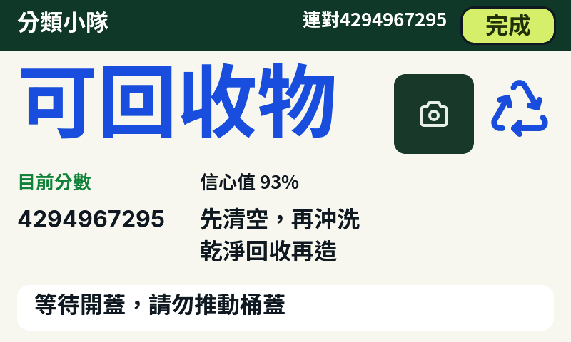
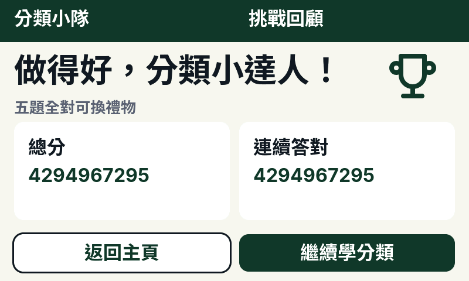

| 變體 | 量測 | 判定 |
|---|---|---|
| result-cat-1／2／3、learning-cat-1／2／3 | 只換類別名、類別色與 tip／example；112 px 四字 ink 寬 439 < 512 框；example 最長 ink 右緣 300（框 48–751） | 一致 |
| result-max（分數／連對 = `UINT32_MAX`） | 兩者降為 32 px 數字字型；分數 ink 25–229（右距 26 px）；status 換 26 px caption，ink 424–647 與「完成」按鈕 **0 px 間距** | 不截斷；邊界過緊 |
| summary-max | 總分 ink 49–253、連對 ink 433–637，皆 32 px，未截斷 | 一致 |
| 32 px 數值在 96 px 卡位 | 文字頂對齊（ink y=295 起），與 80 px 數值的視覺基線不同 | 輕微不對齊 |

## 差異排名（由影響大至小）

1. **`result_ok` 的「完成」是頂欄角落按鈕，128×48。**
   它與 `layout.json` 一致（Figma 本身也是角落按鈕），但直接違反 `AGENTS.md`「主按鈕全寬貼底；不要放角落按鈕」與 `control_height = 64`：寬少 **624 px**、高少 **16 px**，而且它是該屏唯一按鈕。同時它是預設焦點，3 px 外框也落在頂欄內。修法要同時改設計稿與 C。
2. **`category_guide`／`learning` 底列與設計來源互相矛盾。**
   `design/layout.json` 與 `design/issue-3.md`（L54、L55、L293）仍是「返回成績／返回圖鑑＋返回主頁」；渲染是「問綠豆知多啲＋返回主頁」與單粒「下一回合」。幾何：`learning` 少一粒 368×64、主鈕寬 +384 px。程式與 `ui/lvgl/README.md` 一致，所以是**設計檔過期**，但必須回 Figma 確認並重匯出，否則下一個人會照舊圖改返轉頭。
3. **`classifying` 的七階段列無法顯示真實階段。**
   以 `comp/round-phases` 取代 `comp/instruction`，內距 24→16（**−8 px**）；`phase/0` 永遠 brand 高亮，因為 `stc_payload_t` 冇 phase 欄位。畫面聲稱有進度但實際靜止，比原本單行提示更容易誤導。
4. **`summary` 卡片被壓矮。**
   卡高 192→168（**−24 px**）、y +24、底部內距 24→**0**；「五題全對可換禮物」新節點與 prompt 框距 0、與卡片框距 4 px（token 要求 8／16）。數值 80 px 貼住卡底。
5. **預設鍵盤焦點外框越出安全邊。**
   `category_guide` 首張卡外框畫到 x=21（安全邊 24，**−3 px**），`result_ok` 按鈕外框畫到 x=645、y=9；Figma 完全沒有此狀態，開屏即出現。
6. **`result_retry` 沒有任何可按的按鈕。**
   與 Figma 一致，但違反「一屏一個主行動」；小朋友只會盯着「再放回台中央」等控制程式。
7. **`result_ok` 縮圖與類別圖示只有 16 px 間距**（`icon_gap` 24，**−8 px**）。
8. **按鈕圓角無設計依據。**
   `layout.json` 的 button 節點沒有 `radius`，`generate.py` 用預設 16；渲染的 16 px 圓角不能算「已對齊 Figma」。
9. **原色 vs RGB565**（每通道最多 7）與 **32 px 數字頂對齊**屬可接受或需微調，不算結構問題。

## 未能比對的部分（Figma 匯出沒有這些資料）

- **文字對齊、行高、字距、字重**：`design/layout.json` 只有 x／y／w／h／`font` px／顏色／文字；沒有 textAlign、lineHeight、letterSpacing、fontWeight。例如 topbar `status` 是左對齊在 424 起、右邊留白 320 px，無法證明與 Figma 相同。
- **按鈕圓角**：如上，JSON 缺 `radius`，生成器自行補 16。
- **圖示資產對應**：JSON 的 `icon` 節點冇 asset id，C 用 `asset` index（`stc_icons[0..3]`）；只能確認「四類圖示都出到」，不能確認與 Figma instance 是同一粒 SVG。
- **互動狀態**：Figma 匯出無 hover／pressed／focused／disabled；LVGL 的 3 px 焦點外框、掃描光條 260 ms 透明度動畫、`M` reduced-motion 皆無設計對照。
- **動態文案**：`error_code` 三種標題、`lid_open=true`「桶蓋已開，請投放」、`previous`「上一輪：…」、`UINT32_MAX` 降字級，全部由程式決定，JSON 只有單一示範值。
- **Figma 檔案本身**：本機冇 Figma token／MCP，只讀得到 `design/*.json`／`*.md`，所以**無法判斷是 Figma 檔案舊、抑或匯出冇更新**。
- **字形 raster**：Figma 與 LVGL 用不同 rasterizer（4 bpp 子集 vs FreeType），只能比字面 ink bbox，不能比 hinting／邊緣灰階。
- **實機**：800×480 面板 gamma／背光、觸控 mapping、ESP32-S3 目標編譯與 flash／RAM 都不在本輪（`validation-summary.json` 記為 `NOT_TESTED`）。
- **截圖幀數限制**：管線固定 17 幀（`prepare_eval.py` 斷言 17），所以 error 三種文案、`lid_open=true`、`cutout` 影像没有獨立 PNG；改幀數會同時改 manifest、視覺審閱紀錄與 docs 連結追蹤，不在本次範圍。

## 重現

```sh
cmake -S ui/lvgl/preview -B /tmp/stc-ui-build -G Ninja -DCMAKE_BUILD_TYPE=Debug -DLVGL_DIR=/tmp/lvgl-9.5
cmake --build /tmp/stc-ui-build --parallel 8
ctest --test-dir /tmp/stc-ui-build --output-on-failure          # 1/1 Passed
ui/lvgl/tools/.venv/bin/python ui/lvgl/tools/capture.py         # 17 PNG，SHA-256 與 render-manifest 相同
```

`-DLVGL_DIR` 只是本機 build cache 變數，不會 commit LVGL；repo 預設路徑是
`firmware/xiaozhi-esp32/managed_components/lvgl__lvgl`（此 checkout 未安裝）。
