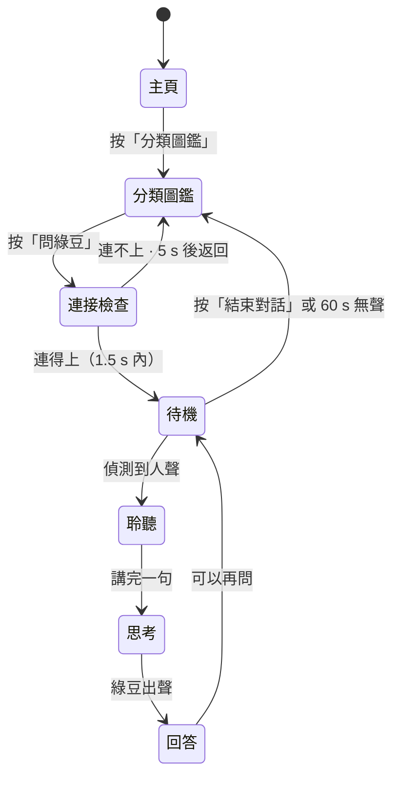

# 資訊模式（綠豆）使用流程 — v1.4

狀態：**流程已定稿，畫面已落地**（2026-11-06）。設計來源：Discord grill Q1–Q10 ＋ 11/06 修訂。
相關：`docs/mode-gate.md`（模式閘）、`docs/ai-chat-implementation-plan.md`（語音架構）。
圖：`docs/images/info-mode-flow-v14.pdf`（3 頁，含流程圖）。

---

## 0. 一句話

主頁只有兩顆按鈕：開始挑戰、分類圖鑑。入圖鑑之後問綠豆。對話完返回圖鑑，遊戲進度不受影響。

---

## 1. v1.4 與 v1.3 的差異

| 項目 | v1.3 | v1.4 |
|---|---|---|
| 入口 | 主頁「問小智」 | **分類圖鑑內「問綠豆」**（唯一入口） |
| 角色 | 小精靈 ＋ 海豚（對話） | **統一為綠豆**；海豚、小智全部退役 |
| 骨架 | 各頁自行編排 | **四區骨架**：24 邊距、TOPBAR 56、BODY 272、ACTION 88 |
| 狀態數 | 4（待機／聆聽／思考／回答） | **7**：加離線、聽唔清、倒數 |

`docs/mode-gate.md` 仍寫「CHAT 只能由 SUMMARY 進入」，本文件與之不符；轉移表改動屬模式閘實作，另一 PR 處理。

---

## 2. 流程

流程只有一條，沒有第二個入口。圖鑑同時是入口與出口。

---

## 3. 四區骨架（800 × 480）

| 區 | 高度 | 內容 |
|---|---|---|
| TOPBAR | 56 | 左「問綠豆」、右連線狀態 |
| BODY | 272 | 狀態字 40 px、對話卡 632×152、提示 26 px、綠豆 88 |
| ACTION | 88 | 一至兩顆按鈕，232×88，貼右下 |
| 留白 | 24 | 四邊，含頂與底 |

24 + 56 + 8 + 272 + 8 + 88 + 24 = 480。數字全部落在 8 網格。

BODY 內部：狀態字在左上；對話卡在左（內含「綠豆」標籤 28 px ＋ 正文 36 px）；綠豆 88 在右上；提示在卡下。

### 字幕規則

| 情況 | 顯示 | 原因 |
|---|---|---|
| 小朋友講嘢 | ASR 逐字稿即時出現 | 讓小朋友知道被聽見 |
| 綠豆回答 | 文字同步出聲 | 聽唔清可以睇 |
| 辨識失敗 | 「聽唔清楚，再講一次」 | 不猜內容 |
| 綠豆唔知 | 「我唔肯定，不如問老師」 | 寧願不答，不要教錯分類 |

---

## 4. 七個狀態

| 畫面 | 綠豆表情 | 狀態字 | 按鈕 |
|---|---|---|---|
| `chat2/01-ready` | 待機 | 有咩想問？ | 結束對話 |
| `chat2/02-listening` | 聆聽（聲波） | 聽緊你講 | 結束對話 |
| `chat2/03-thinking` | 待機 | 諗緊 | 結束對話 |
| `chat2/04-answering` | 講嘢（聲波） | 綠豆話 | 結束對話 |
| `chat2/05-offline` | 傷心 | 暫時未能連線 | 重試 ＋ 結束對話 |
| `chat2/06-asr-retry` | 疑惑 | 聽唔清楚 | 結束對話 |
| `chat2/07-countdown` | 待機 | 仲想問？ | 結束對話 |

按鈕一律 232×88，label 32 px。Figma 位置：D-final page，y = 2600 起，4 個一行。

---

## 5. 綠豆角色

同一角色、六個表情，不加配件。資訊模式靠聲波與狀態字分辨。

| 表情 | 用在 |
|---|---|
| 待機 | 主頁、總結、對話待機 |
| 開心 | 答對、慶祝 |
| 疑惑 | 偵測唔到、聽唔清 |
| 傷心 | 答錯、離線 |
| 聆聽 | 收音中，右側兩條聲波 |
| 講嘢 | 出聲中，右側兩條聲波 |

尺寸只有 88 與 64 兩級，最小 56。主體 `#176640`、內部 `#FBF7EC`。
Figma components：Components page，`mascot/綠豆/idle｜happy｜puzzled｜sad｜listen｜talk`。

---

## 6. 已定決定

| 項目 | 決定 | 理由 |
|---|---|---|
| 入口 | 只有圖鑑一個 | 4–8 歲；入口多過一個等於多一個選擇 |
| 對話記憶 | 開啟，畫面保留最近 2 輪氣泡 | 綠豆能接上文；太多氣泡會變成閱讀功課 |
| 字幕 | 逐字稿 ＋ 回答（選項 B） | 聲音與文字雙通道；ASR 錯字風險已知並接受 |
| 離線處理 | 先探測 1.5 s；失敗顯示重試，5 s 後回圖鑑 | 現場 Wi-Fi 不穩，不能黑畫面 |
| 角色 | 統一綠豆，六表情，不加配件 | 兩個角色會令小朋友混淆「邊個識答」 |

---

## 7. 待辦

1. 圖鑑頁加「問綠豆」入口（現時尚未實作，入口按鈕暫在主頁）。
2. 主頁刪走殘留的海豚圖層。
3. 決定 03 與 07 是否需要專屬「諗緊」表情。
4. 依本文件更新 `docs/mode-gate.md` 與 `contracts/stc_mode.h` 轉移表（另開 PR）。
5. `stc_ui.h` 由 3 屏擴到 7 個 chat 狀態。
