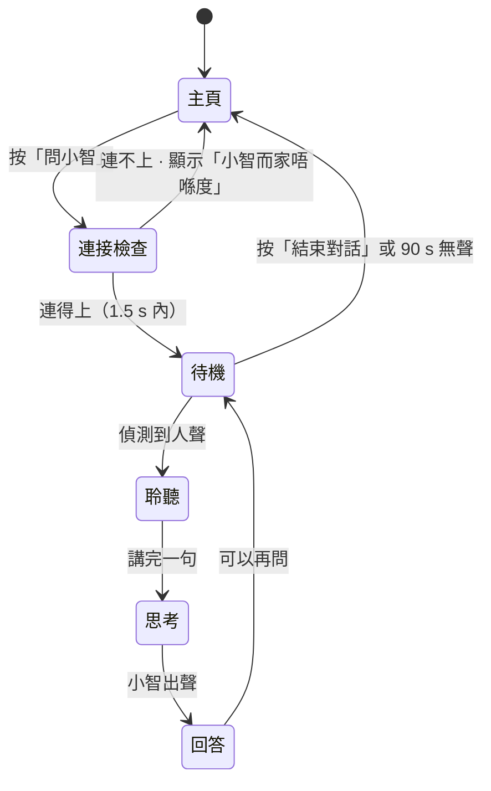

# 資訊模式（小智）使用流程 — v1.3

狀態：**流程已定稿，等落地**（2026-11-06）。設計來源：Discord grill 會議 Q1–Q10。
相關：`docs/mode-gate.md`（模式閘）、`docs/ai-chat-implementation-plan.md`（語音架構）。
圖：`docs/images/info-mode-flow.pdf`（3 頁，含流程圖）。

---

## 0. 一句話

主頁加一個「問小智」入口，進入小智語音對話；對話完返回主頁，遊戲進度不受影響。

---

## 1. 與 `mode-gate.md` 的差異（必須同步）

`docs/mode-gate.md` v1.0.0 寫的是「CHAT 只能由 SUMMARY 進入」。
現決定改為 **只由主頁（GAME_IDLE）進入**，SUMMARY 不再有入口。

| 項目 | 舊（mode-gate v1.0.0） | 新（本文件 v1.3） |
|---|---|---|
| 入口 | SUMMARY，長按 SET ≥800 ms | **GAME_IDLE，主頁「問小智」按鈕** |
| SUMMARY 入口 | 有 | **取消** |
| 回合中進入 | 硬性拒絕 | 硬性拒絕（不變） |
| 退出 | SET 或講「唔玩」 | 「結束對話」按鈕、SET、講「唔玩」 |
| 閒置逾時 | 60 s | **90 s**，最後 15 s 顯示倒數 |

`contracts/stc_mode.h` 的轉移表需要同步：`STC_ST_GAME_IDLE × STC_IN_CHAT_ENTER → STC_ST_CHAT`，
以及 `STC_ST_SUMMARY × STC_IN_SET_LONG` 改為拒絕。此改動屬 issue「模式閘實作」，不在本文件範圍。

---

## 2. 流程

四個狀態（待機／聆聽／思考／回答）各有固定畫面元素，位置不跳。

---

## 3. 畫面規格

自上而下三層：

| 層 | 內容 | 規格 |
|---|---|---|
| 頂部 | 小精靈（戴圓框眼鏡） | 替換遊戲中的原版；尺寸沿用 S2 hero 88 px |
| 中層 | 狀態字，四選一 | 「有咩想問？」「聽緊你講」「諗緊」「小智話」 |
| 底部 | 字幕區 | 最多 2 行，40 px，Noto Sans TC Bold |

右下角只有一顆按鈕：**結束對話**，88 px 高，實心 `color/brand` 綠。

### 字幕規則

| 情況 | 顯示 | 原因 |
|---|---|---|
| 小朋友講嘢 | ASR 逐字稿即時出現 | 讓小朋友知道被聽見 |
| 小智回答 | 文字同步出聲 | 聽唔清可以睇 |
| 辨識失敗 | 「聽唔清楚，再講一次」 | 不猜內容 |
| 小智唔知 | 「我唔肯定，不如問老師」 | 寧願不答，不要教錯分類 |

---

## 4. 五個已定決定

| 項目 | 決定 | 理由 |
|---|---|---|
| 入口 | **只有主頁一個** | 4–8 歲；三個入口等於三個選擇 |
| 對話記憶 | 開啟，畫面保留最近 2 輪氣泡 | 小智能接上文；太多氣泡會變成閱讀功課 |
| 字幕 | 逐字稿 + 回答（選項 B） | 聲音 + 文字雙通道；ASR 錯字風險已知並接受 |
| 離線處理 | 先探測 1.5 s；失敗顯示「小智而家唔喺度，玩住遊戲先？」，5 s 後回主頁 | 現場 Wi-Fi 不穩，不能黑畫面 |
| 小精靈 | 加圓框眼鏡作識別物 | 同一角色兩個狀態，不新增角色 |

---

## 5. 小精靈角色表（待出）

同一角色，兩個狀態。戴眼鏡代表「識答問題」。

| 狀態 | 表情 | 用途 |
|---|---|---|
| 原版 | 待機、開心、疑惑、傷心 | 遊戲畫面 |
| 戴眼鏡 | 聆聽、講嘢 | 資訊模式 |

輸出：6 個表情，4 欄 3 列，附色票與最小尺寸。表情數量待確認（6 或 4）。

---

## 6. 待辦

1. 確認角色表表情數量。
2. 出小精靈角色表（含戴眼鏡版本）。
3. Figma 新 page 開三個畫面：主頁改版、資訊模式待機、對話中。
4. 依本文件更新 `docs/mode-gate.md` 與 `contracts/stc_mode.h` 轉移表（另開 PR）。
